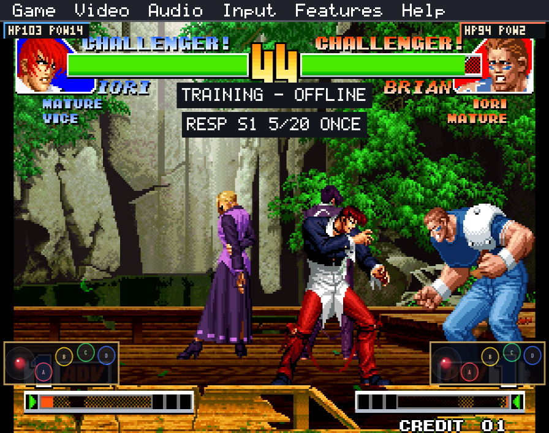
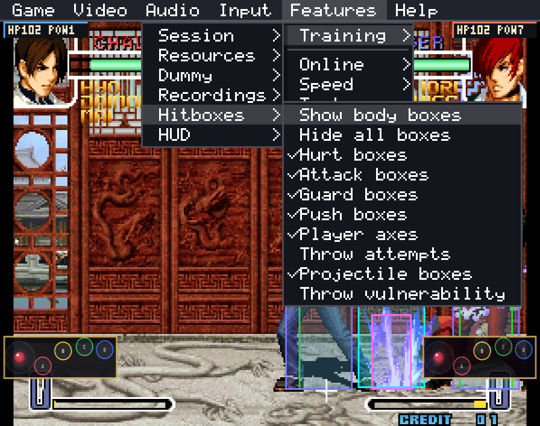
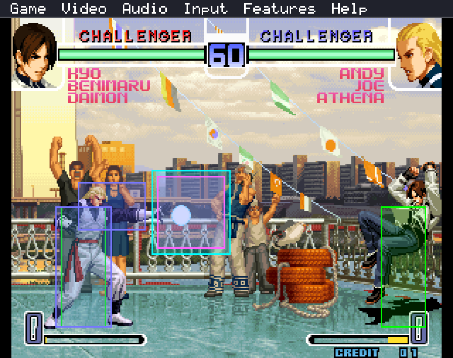

# Training development report

Snapshot: **24 November 2026**, Mexico City. This report covers the local work
since the published `main` revision `1e41731143f892d55cd0ee98d92734ddf0780cb3`,
checked against GitHub on that date. **The implementation changes described here
are still local and require a separate reviewed source publication.** A documentation
update alone does not make these features available in a fresh clone of that revision.

These are native development candidates using this project's Neo Geo board and
68000 interpreter. They are not evidence of complete static CPU translation,
an installed launcher update, or new Internet-play acceptance.

## What was built and checked

| Capability | KOF98 | Original KOF2002 | Magic Plus II |
| --- | --- | --- | --- |
| Offline session, health/time aids, read-only power | Qualified candidate | Independently qualified | Independently qualified |
| Three bounded input slots and deterministic playback | Qualified candidate | Qualified candidate | Qualified candidate |
| Standing/low and random guard intentions | Qualified samples | Qualified samples | Qualified samples |
| Conservative recorded-slot recovery response | Iori/Brian and Kyo/Yuri samples | Kyo/Iori samples | Independent Kyo/Iori samples |
| Body hurt/attack/guard/push boxes and axes | Qualified samples | Own profile, including hurt ID23 | Own qualified profile |
| Read-only projectile boxes | Sampled Iori evidence | Expanded sampled matrix below | Expanded independently |
| Yellow transient throw-attempt areas | Ordinary and one Iori command-throw sample | Ordinary C/D samples | Independent ordinary C/D samples |
| Light-grey defender throw vulnerability | Not qualified | Reference-derived area | Independently qualified area |

KOF95 and KOF97 retain the shared current-input presentation, but this work does
not qualify native training adapters for those sets. A parent game's result never
automatically qualifies a bootleg or another cartridge.

## Using the local development features

Open **Features > Training > Session** and start a session. P1 chooses both teams
through the normal game flow. The menu separates **Session**, **Resources**,
**Dummy**, **Recordings**, **Hitboxes** and **HUD**.

Under **Recordings**, select one of three slots, record an input sequence, and stop
the dummy action. Each slot is bounded to 1,800 frames. Playback supports the
qualified deterministic modes; only populated slots participate in random playback.

Under **Dummy > Recovery response**, select block, hit, airborne-hit or any sampled
recovery event. The chosen recording plays once after a conservative recovery
signal; **RESP** identifies automatic ownership. Empty slots do nothing. Explicit
record/play commands take priority. This is **not a first-frame reversal** or a
universal wake-up detector. Random guard uses attack-button episodes, not automatic
attack-height or collision classification.

Training mutation, dummy injection and collision overlays are guarded outside
offline practice, including online and replay viewing. HP/time aids use qualified
per-set fields; power remains read-only. Magic Plus II's naturally full power is
not an adapter refill.

The shared controls reuse the requested recorder artwork: Neo Geo A/B/C/D colours,
a current-direction stick, no redundant P1/P2 labels and no input-history list in
the panels. The accepted panels are reduced by 25%, blended at 88% opacity and
anchored above the super meters. Verified numeric HP/POW badges sit above the portraits.

## Reading the collision overlays

| Colour | Meaning in these candidates |
| --- | --- |
| Blue | Player hurt area |
| Red | Player attack area |
| Pale blue | Guard detection area |
| Green | Player separation/push area |
| Magenta / cyan | Projectile attack / vulnerability |
| Yellow | Transient attacker throw attempt |
| Light grey | Reference-derived defender throw vulnerability, KOF2002 family only |

Each type has a separate control. **Hide all boxes** disables the overlays, including
projectiles and both qualified throw views. Projectile lists are bounded to 64
objects; malformed or capped traversals discard incomplete projectile results
while preserving valid player boxes. Object-list order does not establish ownership.

Yellow areas can last one displayed frame. Pause can retain the observed event;
load/reset/context changes discard stale events. Grey defender areas are recomputed
from the current qualified profile and respect its suppression flags/timer. Neither
area guarantees that a particular command, aerial or ordinary throw will connect.

## Projectile coverage: specific inputs, not a roster percentage

Original KOF2002 and Magic Plus II independently cover these sampled sequences:

| Fighter / ordinary input | P1 right / left initial facing | P2 left / right initial facing |
| --- | --- | --- |
| Athena, quarter-circle-back + A or C | Both sampled | Both sampled |
| Terry, quarter-circle-forward + A | Both sampled | Both sampled |
| Kensou, quarter-circle-back + A or C | Both sampled | Both sampled |
| Andy, quarter-circle-back + A or C | Both sampled | Both sampled |

These seven input sequences have their own per-set evidence. Fighters were selected
through normal menus. Jump/walk crossings established opposite-side states with
facing and X-order assertions; no fighter-ID or position patches were used. P2
exercises use the bounded dummy-recording route and check the other player's input
remains neutral. This does not certify physical-controller mapping.

Every expanded input exercise compares 900 visibility-off with 900 visibility-on
frames, preserving hashes and PCM. Native presentation checks expected geometry
and unchanged complete board/game state. Actual original Lua is an independent
geometry reference on copied native RAM snapshots. The evidence retains differences
between sets rather than forcing identical sample counts.

For example, the last Kensou/Andy expansion adds **848 snapshots / 1,622 projectile
rectangles** for original KOF2002 and **864 / 1,649** for Magic Plus II. These are
sample counts, not a percentage of all collision behaviour or functions.

The initial Athena forward-motion recipe produced no projectile and was rejected
as positive evidence. Terry's tested C sequence likewise produced no projectile
and is retained only as an observed control. Failed recipes are not counted as moves.

See the [coverage matrix and its per-set receipts](../openspec/changes/neogeo-training/projectile-coverage.md)
for the exact evidence chain, hashes, scope and limitations.

## State compatibility and candidate identity

KOF98's recovery-response candidate uses training mark58 and imports qualified
marks54–57. Invalid fields reject through atomic board/game rollback. Original
KOF2002 uses `0x4b303201`; Magic Plus II uses `0x4b4d3201`. Qualified legacy
board-only states import with empty training data. Original and variant training
tails are deliberately separate; **do not exchange their states**.

Older executables cannot necessarily read newer training tails. Keep old candidates
and their user data separately. The later collision/coverage work did not change
these state schemas or replace the accepted candidates.

| Accepted local candidate | EXE SHA-256 |
| --- | --- |
| KOF98 recorded response | `f8d76ee1e31bd4c49e5a4ef18508377f189614e2fffbcaa8590e118e1b01e3b8` |
| KOF2002 projectile candidate | `ab85e14888d2845ea3bae16073a0195d3155488e3e558599b046e7fee2826893` |
| Magic Plus II projectile candidate | `752c0220018852d2d4e0b797115969a96cef106d625a1626cec9b18bb6254ded` |

## Evidence, acceptance and reproducibility

The developer/player explicitly accepted the local menus, controls and tested
collision/projectile candidates. Expanded Kensou/Andy/Athena role/facing samples
are automated qualification; they are not a separate human full-roster playthrough.

The recorded build qualifications include 13/13 CTest checks for the KOF98 response
candidate and 14/14 for each KOF2002-family collision candidate. Their receipts
also distinguish state migration, malformed loads, native lifecycle, visibility
regressions and guarded rollback. Those are historical executions bound to the
recorded EXE hashes; documentation-only changes did not rerun CTest or Internet tests.

Public evidence contains aggregate JSON metadata, original-source fingerprints and
authorised native PNG captures. ROMs, BIOS, decrypted data, RAM snapshots, savestates,
raw PCM, state-bearing replays and private Lua wrappers are not publication material.
The geometry runs require owned game data; no private fixtures are distributed as
a substitute. This report is not a claim that every local oracle run is reproducible
from public files alone.

Use [the source build guide](BUILDING.md) for the currently published checkout.
Reproducing the newer development functionality requires the reviewed implementation
changes to be published separately. The evidence index is the
[OpenSpec validation record](../openspec/changes/neogeo-training/validation.md), with
[remaining tasks](../openspec/changes/neogeo-training/tasks.md) and detailed instructions
for [KOF98](../games/kof98/README.md), [KOF2002](../games/kof2002/README.md) and
[Magic Plus II](../games/kf2k2mp2/README.md).

## Credits and remaining work

The runtime/menu foundation comes from **Tommy McLeroy's cps2recomp and recomp-common**.
Neo Geo hardware/set research and sound dependencies retain the **MAME team** and
**Aaron Giles/ymfm** credits. Collision geometry research uses **peon2 and the
fbneo-training-mode contributors**, including the historical viewer authors cited
by their KOF viewer. The inspected Lua SHA-256 is
`91db43f2ce34065afed445662afcfe5001c4bbd94b271f63105dc0e238942531`;
it is not assumed equal to a later upstream revision.

Recovery-field hypotheses credit **willococa's training extension**, pinned at
`4ecc81bb0e75522c8f5067641ec83f54c7d55530`. Current control artwork was reused from
the owner's recorder at their request, with **Barlow** lettering under SIL OFL1.1.
InputDisplay's historical research assets and their provenance remain separate
from the active renderer. Full notices and source links are in
[THIRD_PARTY_NOTICES.md](../THIRD_PARTY_NOTICES.md).

Still pending: full-roster/move and repeated-crossing coverage; broader command/air
throws; first-frame reversals; measured frame advantage/combo/stun; KOF95/KOF97 native
training adapters; a fresh clean-clone qualification after implementation publication.
OpenSpec also retains the unresolved inherited-licence audit gates before publishing
any literal reference-source adaptation. No new online-performance, rank or latency
claim follows from these offline viewer tests.
