# The King of Fighters 2002 Magic Plus II

> Development status, 24 November 2026: newer training features and captures below
> describe local candidates whose implementation changes are pending separate source
> publication. See [the development report](../../docs/TRAINING-DEVELOPMENT.md).

The `kf2k2mp2` bootleg variant, using the Neo Geo runtime (68000 interpreter). This is not the original
KOF2002 cartridge or Magic Plus I. Supply your own `kf2k2mp2.zip`, `kof2002.zip` and `neogeo.zip` beside each other.
No game or BIOS files are distributed.

## Offline training (development candidate)

The variant has its own qualified Session, Resources, Dummy, Recordings and HUD
adapter, plus separately qualified player-box views. Record an action in **Features > Training > Recordings**, stop recording,
then choose **Dummy > Recovery response** (block, hit, airborne hit or any).
The selected slot plays once after the conservative recovery signal; **RESP**
identifies automatic ownership. Explicit record/play actions have priority.
Empty slots do nothing, and training is disabled online/in replay viewing.

Optional life/time aids use the measured variant profile. Power/stocks are
read-only: this hack's naturally full power is not an adapter refill. Random
standing/low guard uses attack-button episodes; it does not infer attack height.
Player boxes and sampled throw attempts are described below; sampled projectile and defender areas are described below.

The variant state mark is `0x4b4d3201`. Legacy board-only variant states import
empty training data; the original game's training tail is rejected atomically.
New training states require this or a compatible newer build. Keep original
KOF2002 and Magic Plus II user folders separately.

Qualification covers the initial Kyo/Iori fixture, 20 response-policy cases,
active-response state continuity and matched low-guard controls. This is not
first-frame reversal or complete roster/hack-mechanic coverage. See
[variant training evidence](../../openspec/changes/neogeo-training/kf2k2mp2-training-receipt.json).

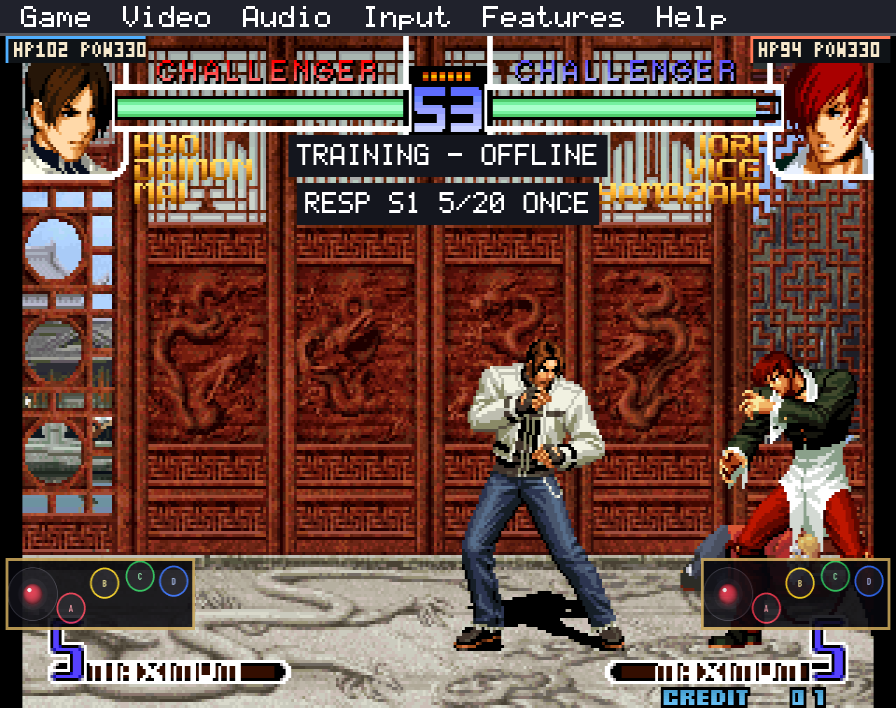

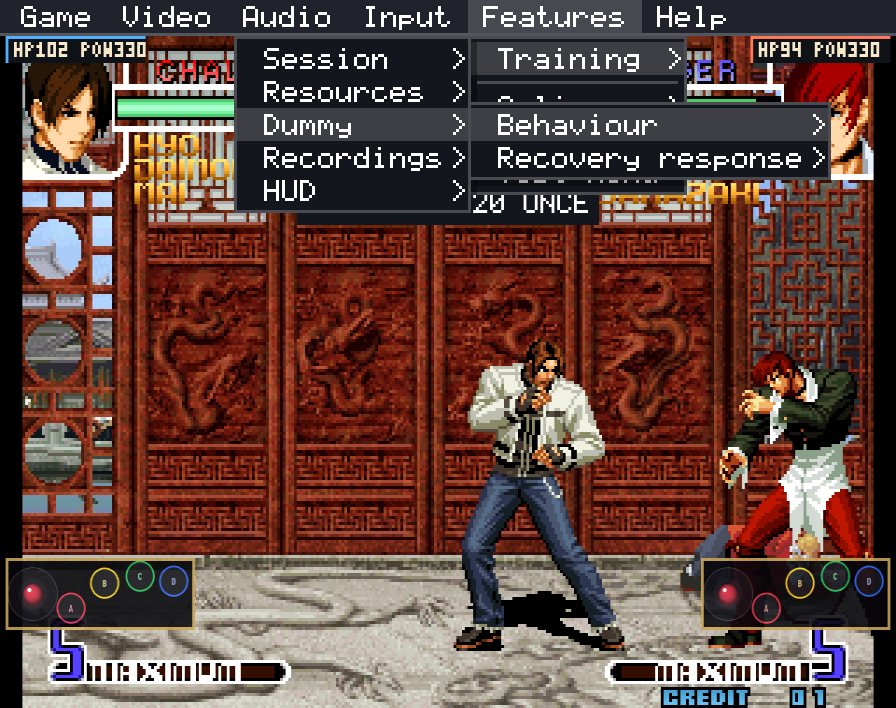

### Player hitboxes

Use **Training > Hitboxes > Show body boxes**. Blue shows vulnerability, red
attacks, pale blue guard, green separation; white crosses show player axes.
Each type has a switch, and **Hide all boxes** clears them all.

The variant independently matches the original Lua profile in600 snapshots,
covering both facings, camera movement and jumps. It uses phase0x10b056 and
camera0x10b08e with hurt ID23. Paused load/reset recompute player geometry;
outside practice, online and replay viewing hide it. No state-format change is
needed. Full roster and frame advantage are
not certified by this sample. See [variant evidence](../../openspec/changes/neogeo-training/kf2k2mp2-hitboxes-receipt.json).

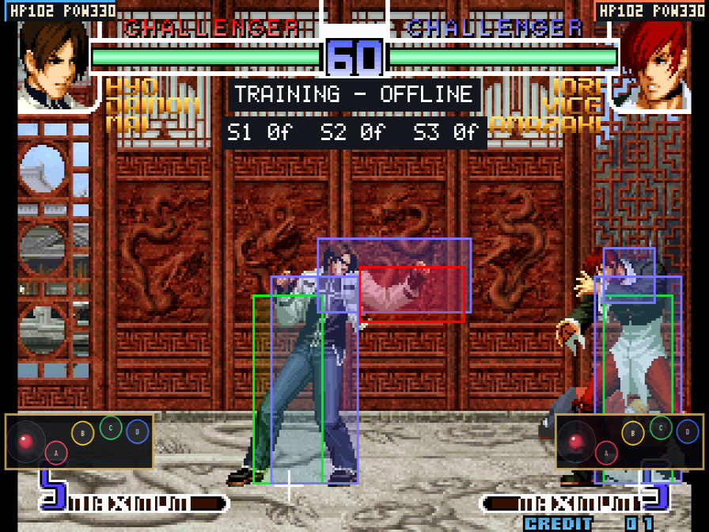

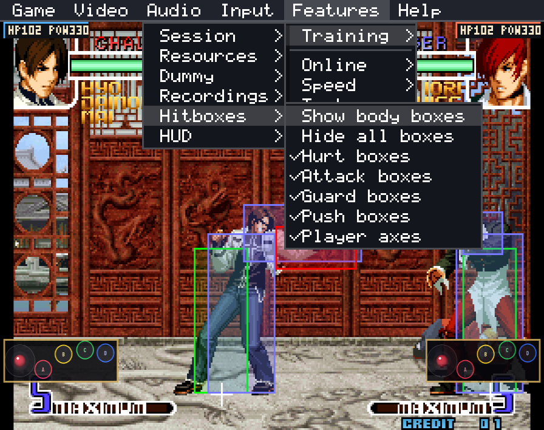

### Throw attempts

**Training > Hitboxes > Throw attempts** shows yellow sampled attempt areas,
separate from the defender's throwability. Capture uses the variant-qualified
0x10e7b5 watchpoint and0x10b08e camera, bounded to one current-frame event per
player. Paused presentation retains it; load/reset, option/session changes,
online and replay viewing prevent stale-event reuse. Hide all boxes disables it.

Thirty-one C/D attempt samples agree with the original Lua callback for both
players and facings, independently of the original game's tests. This does not
certify command/air throws, every character or all hack mechanics. No new saved
state format is required. See [variant attempt evidence](../../openspec/changes/neogeo-training/kf2k2mp2-throws-receipt.json).

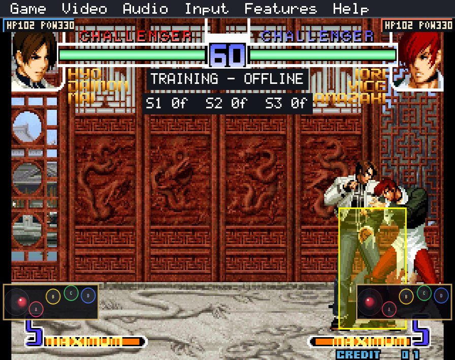

The split clone contains `k2k2m2p1.bin` (CRC 1016806c), `k2k2m2p2.bin` (432fdf53) and `k2k2m2s1.bin` (446e74c5).
Graphics, encrypted M1 and samples come from the original parent. The system set needs `sp-s2.sp1` and the
other BIOS members named in game.cfg. Keep the encrypted 128 KiB M1; do not substitute a prefixed/expanded dump.

## Build and run

In the existing MSYS2 UCRT64 build environment:

```sh
make GAME=kf2k2mp2
build/kf2k2mp2/kf2k2mp2 --rom /path/to/kf2k2mp2.zip
```

Direct startup searches `roms/`, `ROM/`, `rom/` and the executable directory, then the working directory's
`roms/` and its root. Parent and BIOS remain beside the selected set. An explicit `--rom` takes precedence.
The portable test helper uses the central private library explicitly; the deployed ForkAde beta is unchanged.

The pipeline validates all sizes first, relocates the 6 MiB program, applies PCM2 type 0, decrypts CMC50 M1,
swaps each S1 block's eight-byte halves, and decrypts CMC50 sprites. S1 is not extracted from the graphics.
The Z80 continues using linear M1 bytes and the existing fixed/four-bank-window mapping.

## Validation and limits

See [the OpenSpec report](../../openspec/changes/neo-kf2k2mp2/validation.md) for the pinned MAME revision,
independent synthetic oracle, loader/startup tests and original-game regressions. Own title/character-selection/
combat captures were inspected; nonzero PCM audio was measured. These are not full playthrough or Internet
netplay acceptance. Human sound-quality/controller verification remains a player test.

The executable's seven-size Windows icon comes from this variant's own title screen, including MAGIC PLUS II.
The collection's generic discovery includes this game.cfg; the separate maintained ForkAde package/catalogue
has not been updated or deployed by this change.


## Optional ForkAde match flow

`--forkade-online` explicitly enables the native Esc-menu Host/Stop flow,
arcade admission, independent Start prompts, player names/Hide toggles,
completed-human-team streaks and same-peer recovery. The optional Windows
room owner is built with `-DFORKADE_BROKER_DIR=/path/to/ForkAde`; it uses the
bundled tunnel and leaves normal execution/netplay unchanged. This does not
merge the separate menu-bar/training proposal or install a launcher update.

Result addresses were independently verified for this set; see
[the native observations](../../openspec/changes/neo-kof-family-match-flow/native-results.md).
Run `tools/check_neogeo_flow.py --game GAME --forkade-root PRODUCT
--baseline OLD_EXE --rom-dir SETS --out NEW_BUILD_DIRECTORY` for per-game
local acceptance, replacing GAME with this directory's set ID. Local probes
and loopback checks do not establish real Internet/player acceptance.

### Defender throw vulnerability

**Features > Training > Hitboxes > Throw vulnerability** shows a light-grey
reference-derived defender area. Yellow **Throw attempts** describes a different,
transient attacker event. Neither area guarantees that a particular throw connects.
The defender view respects the reference's restrictive status, invulnerability
timer, signed eligibility and proximity-guard conditions; zero-size areas are hidden.

Each set independently matches the original Lua in 600 native snapshots
(1,012 rectangles), plus 16 controls on copied snapshots. The viewer is read-only,
refreshes on paused load/reset, and hides online, in replay viewing and outside
training. **Hide all boxes** disables it too. Same-set save formats are unchanged;
never exchange original/variant states. Full-roster and command/air-throw qualification remains pending; projectile
coverage is described below. See [defender-area evidence](../../openspec/changes/neogeo-training/kf2k2mp2-throwability-receipt.json).

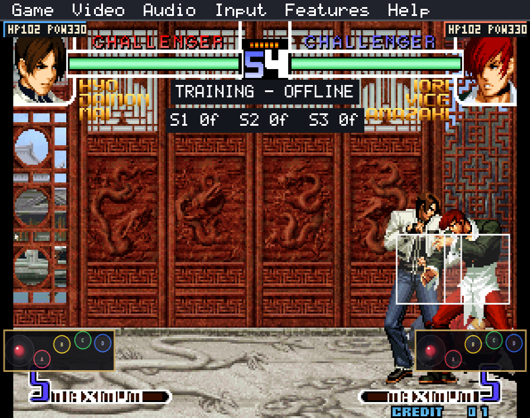

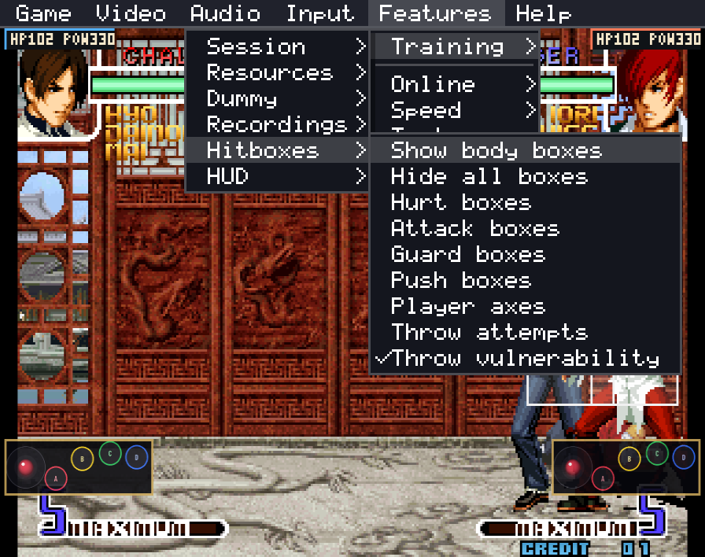

### Projectile boxes

**Features > Training > Hitboxes > Projectile boxes** independently shows magenta
projectile attacks and cyan projectile vulnerability. Body filters remain separate;
**Hide all boxes** disables everything. Ownership is not inferred from list order.
The read-only list is capped at 64 objects and discards incomplete projectile data
on malformed pointers or cap exhaustion while retaining valid player boxes.

This set independently matches the original Lua on native Iori projectile snapshots.
Paused load, expiry, switches, session exit and online/replay-viewing guards are
checked, with unchanged board/training state and audio regression. This does not
qualify every projectile, roster or collision outcome. Same-set save formats and
previous accepted packages remain unchanged. See [per-set projectile evidence](../../openspec/changes/neogeo-training/kf2k2mp2-projectiles-receipt.json).

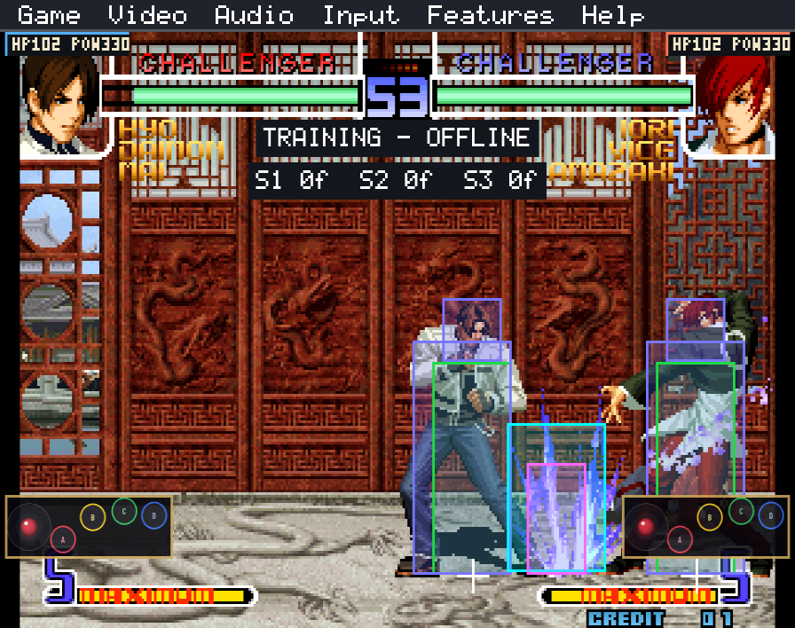

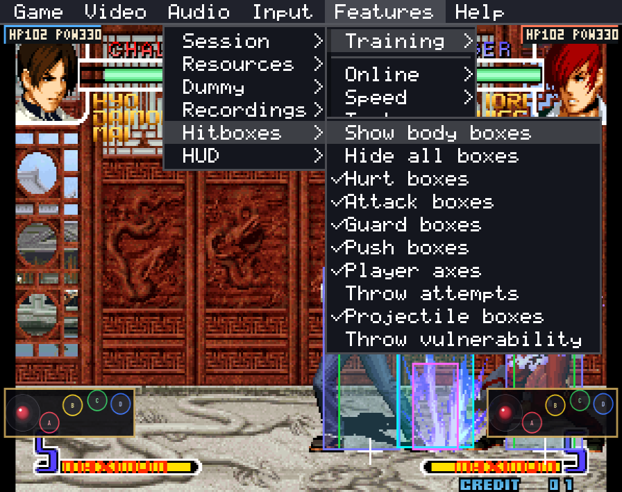

### Additional projectile coverage (24 November 2026)

The accepted projectile executable also matches the original Lua for Terry's
ordinary quarter-circle-forward + A sample: 65 snapshots / 122 projectile
rectangles per set. Each visibility setting preserves hashes and PCM over 900
frames; native presentation preserves complete board/game state. A separate C
sequence produced no projectile and is not counted as positive move coverage.
Terry versus Leona was selected through normal menus, without fighter-ID patches.
No new binary or save format is required. Other moves, fighters and facing
combinations remain unqualified.

[Per-set expanded evidence](../../openspec/changes/neogeo-training/kf2k2mp2-projectile-roster-receipt.json).

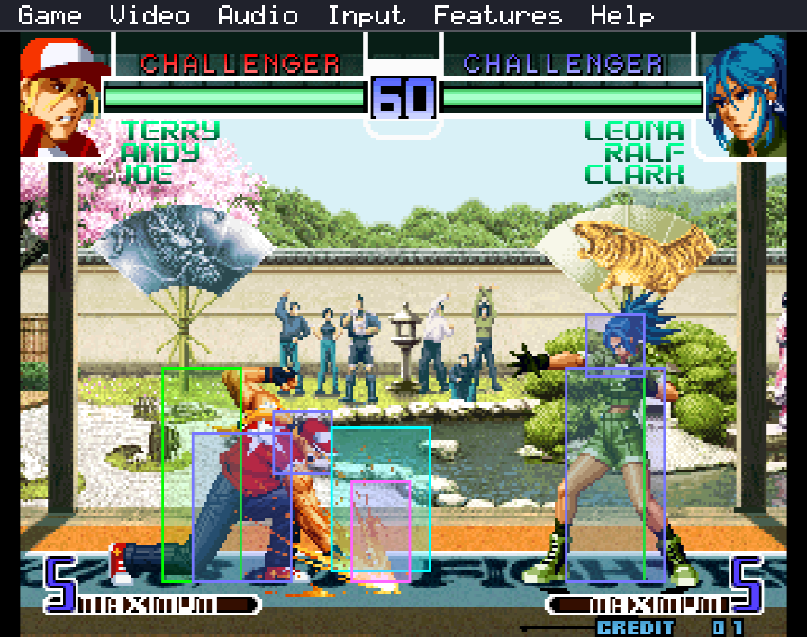

### Athena projectile coverage (24 November 2026)

Athena's normally selected ground quarter-circle-back + A and + C samples
independently agree with the original Lua in this set: 117 + 58 snapshots,
covering 227 + 114 projectile rectangles. Each input has 900 visibility-off and
900 visibility-on frames with identical hashes/PCM and read-only presentation.
No replacement executable is needed. The initial forward-motion attempt produced
no projectile and is not counted as move coverage. Other moves/facings remain
pending. [Athena evidence](../../openspec/changes/neogeo-training/kf2k2mp2-projectile-athena-receipt.json).

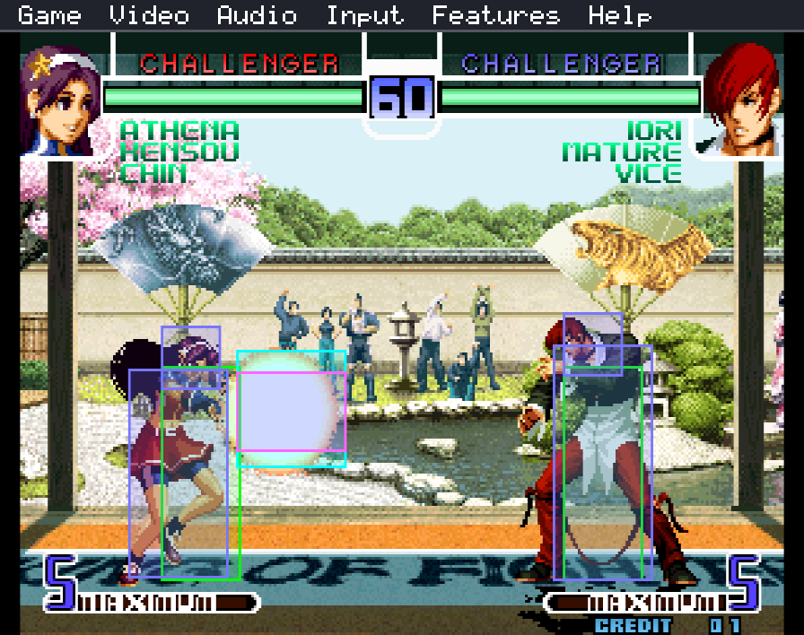

### Opposite initial facing (24 November 2026)

Normal dummy jump/walk inputs cross the players before testing Athena A/C and
Terry A again. Facing and player X ordering are checked; no RAM patch is used.
The left-facing samples add 260 snapshots and 501 projectile rectangles
matching original Lua in this set. Each of three inputs runs 900 frames per
visibility setting with equal hashes/PCM and read-only native presentation.
Together with prior right-facing samples, this covers the two initial orientations
for these particular P1 inputs. P2 roles, continuous crossings and the remaining
roster/moves remain separate work. Accepted executables remain unchanged.
[Opposite-facing evidence](../../openspec/changes/neogeo-training/kf2k2mp2-projectile-opposite-receipt.json).

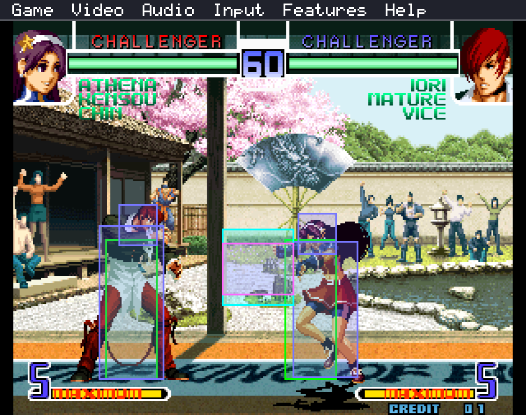

### Player-two projectile coverage (24 November 2026)

Athena A/C and Terry A are also qualified as P2 in this set, from the normal
right-side, left-facing start. Normal selection captures identify each fighter.
The existing dummy-recording route drives P2 while P1 stays neutral; this does
not certify physical-controller mapping or Internet play. Three sequences each
run 900 visibility-off and 900 visibility-on frames with equal hashes/PCM and
read-only presentation. 234 snapshots and 464 projectile rectangles
match original Lua. P2's opposite initial orientation and broader move/roster
coverage remain pending; accepted executables are unchanged.
[P2 evidence](../../openspec/changes/neogeo-training/kf2k2mp2-projectile-p2-receipt.json).

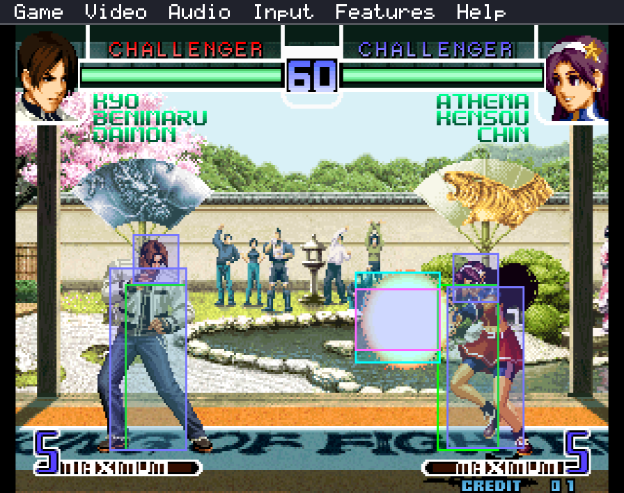

### Crossed player-two facing (24 November 2026)

Ordinary P1 jumps/walking cross P2 to the left side facing right; facing and X
ordering are asserted before the fixture is saved. P2 Athena A/C and Terry A add
252 snapshots / 491 projectile rectangles matching original Lua.
Each input has 900 visibility-off and 900 visibility-on frames with identical
hashes/PCM, P1 neutral during the attack exercise, and read-only native presentation.
Together with prior receipts, both initial facings and both player roles are now
sampled for these three inputs. This is not full-roster/move or dynamic-crossing
certification. Accepted executables remain unchanged.
[Crossed P2 evidence](../../openspec/changes/neogeo-training/kf2k2mp2-projectile-p2-opposite-receipt.json).

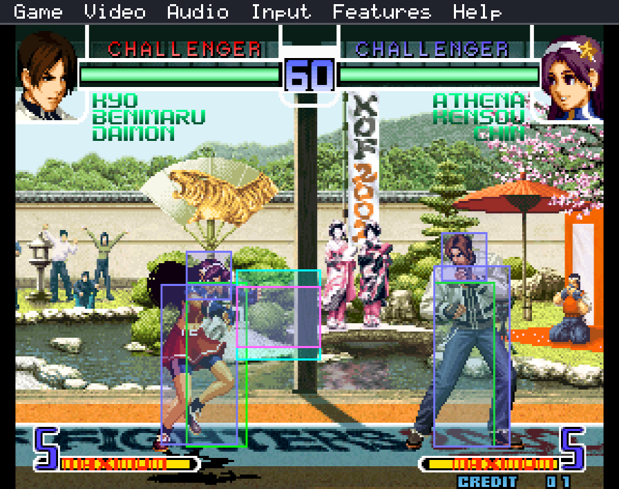

[Sampled role/facing coverage matrix](../../openspec/changes/neogeo-training/projectile-coverage.md).

### Kensou and Andy projectile samples (24 November 2026)

Normal character selection independently reaches Kensou or Andy P1 versus Iori P2.
Quarter-circle-back + A and + C samples agree with original Lua in this set:
272 snapshots / 532 projectile rectangles across four inputs.
Each runs 900 visibility-off and 900 visibility-on frames with identical hashes/PCM,
expected native geometry and read-only presentation. These are initial P1 right-facing
samples only; P2, opposite-facing and broader move coverage remain pending for
these fighters. Accepted executables are unchanged.
[Additional-roster evidence](../../openspec/changes/neogeo-training/kf2k2mp2-projectile-extra-roster-receipt.json).

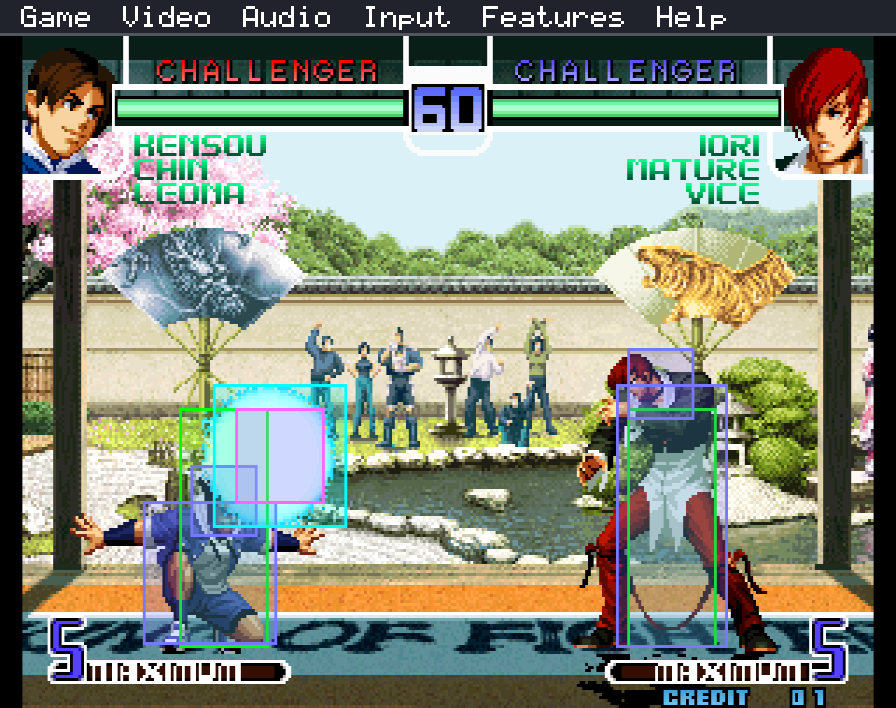

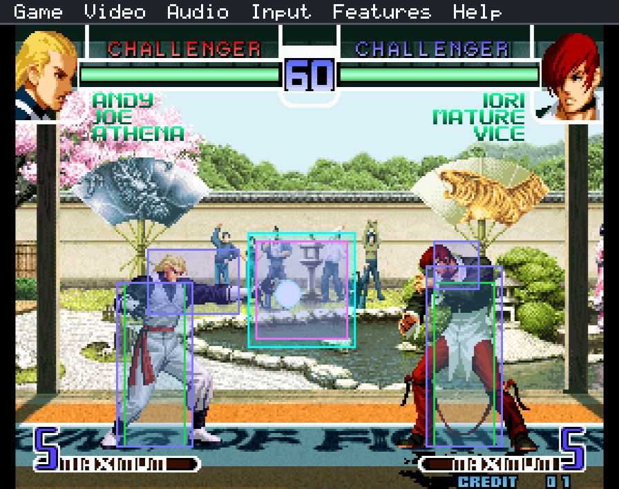

### Kensou/Andy sampled role/facing matrix (24 November 2026)

The remaining P1 left-facing and P2 left/right-facing qcb+A/C samples are now
checked independently in this set: 864 additional snapshots and 1649
projectile rectangles agree with original Lua. Normal P2 selection and jump/walk
crossings establish the fixtures with facing/X-order assertions. Each of twelve
new input exercises has 900 visibility-off and 900 visibility-on frames with
identical hashes/PCM, inactive-player input neutrality and read-only native geometry.
Together with the initial P1 samples, this covers both roles and initial facings
for these four inputs only. Other moves, dynamic crossings and full-roster claims
remain outside this evidence. Accepted executables and saves stay unchanged.
[Expanded matrix evidence](../../openspec/changes/neogeo-training/kf2k2mp2-projectile-extra-matrix-receipt.json).

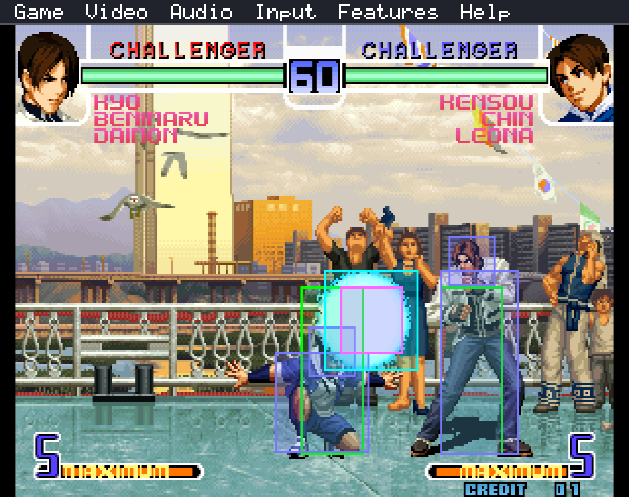

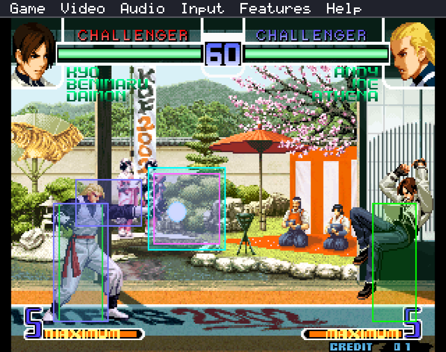
