# The King of Fighters 2002

> Development status, 24 November 2026: newer training features and captures below
> describe local candidates whose implementation changes are pending separate source
> publication. See [the development report](../../docs/TRAINING-DEVELOPMENT.md).

The original MAME/FBNeo `kof2002` cartridge (NGM-2650): runtime P2, CMC50 graphics/M1, extracted FIX and PCM2 samples.
Use your own `kof2002.zip` and `neogeo.zip` (with `sp-s2.sp1`), beside each other. Bootleg, Plus and predecrypted sets
are not accepted by this original-set entry. Magic Plus II has its own [kf2k2mp2 entry](../kf2k2mp2/README.md).
The encrypted `265-m1.m1` is 128 KiB, CRC `85aaa632`; do not replace it with an expanded M1.
No ROM files are part of this change.

## Offline training (development candidate)

**Features > Training** now offers Session, Resources, Dummy, Recordings, Hitboxes and HUD.
Start a session and select both teams using P1. The original-set adapter uses
phase0x10b056, clock0x10a7d2 and the native102-HP bound. Power remains read-only
and includes the separate stock counter. No KOF98 collision table is enabled.

Record an action under **Recordings**, stop recording, then select
**Dummy > Recovery response** (block, hit, airborne hit or any). The selected
slot plays once after the conservative recovery signal; **RESP** identifies
automatic playback. Explicit record/play actions take priority. This is a
post-recovery exercise, not a first-frame reversal. Empty slots do nothing.

Standing/low guard and saved random guard/pass intentions are available. Random
episodes use P1 attack-button input; no collision-based extension or automatic
attack-height detection is claimed. The measured crouching attack is qualified
with matched low/standing/pass controls, not all moves or characters.

The new game-specific state mark is `0x4b303201`. Original KOF2002 board-only
states import with empty training data; invalid new training fields reject
through atomic rollback. Older executables cannot read the new training tail.
Online and replay viewing disable practice mutations and dummy injection.
The first native response fixture is Kyo/Iori; broader roster, multi-hit,
cross-up, throw and first-frame reversal coverage remain pending.
Magic Plus II has a [separately qualified adapter](../kf2k2mp2/README.md); it does not share training states with this original-set entry.

See [original-set training evidence](../../openspec/changes/neogeo-training/kof2002-training-receipt.json).

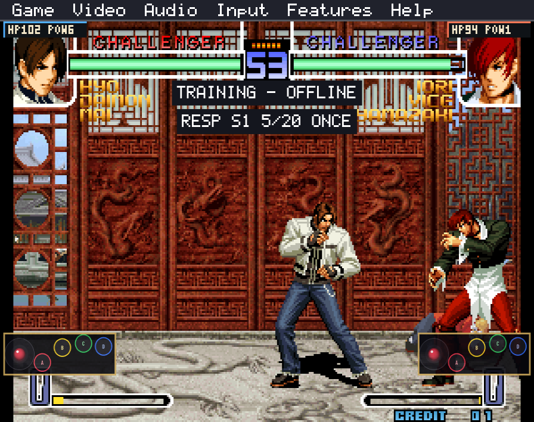

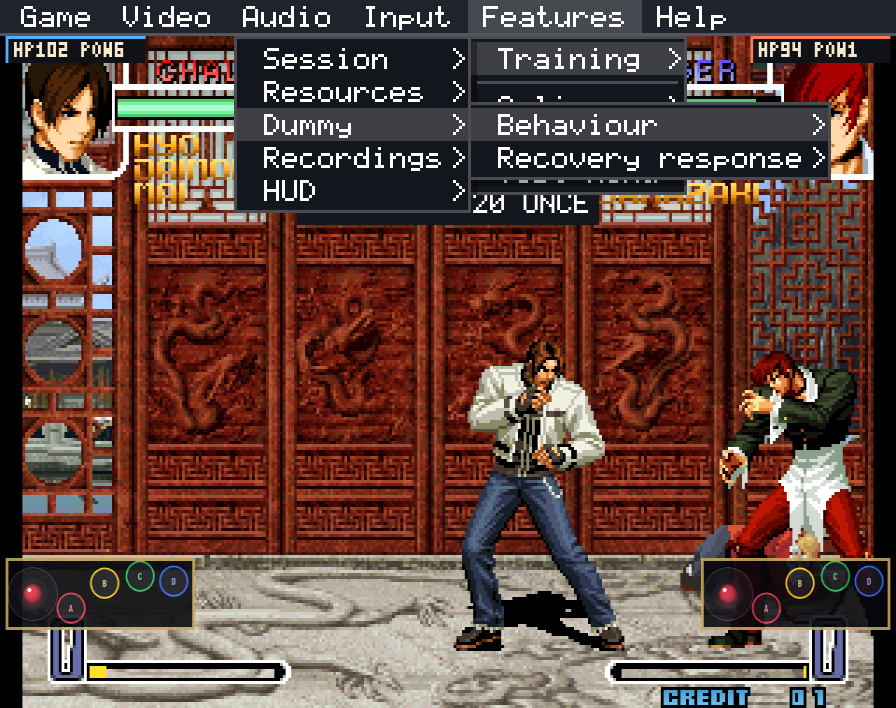

### Player hitboxes

Choose **Training > Hitboxes > Show body boxes**, or toggle hurt (blue), attack
(red), guard (pale blue), push (green) and player axes separately. **Hide all
boxes** disables all five. This original-set profile uses its own camera address
and hurt ID23; it is not the KOF98 table.

Player geometry matches the original Lua in600 native snapshots, including both
facings, camera movement and jumps. Paused load/reset refresh the geometry;
online, replay viewing and session exit clear it. This is a read-only viewer,
not collision-engine certification or frame-advantage measurement. Sampled projectile areas are described below; sampled throw attempts and defender areas are described below. Existing training state format
is unchanged. See [player-box evidence](../../openspec/changes/neogeo-training/kof2002-hitboxes-receipt.json).

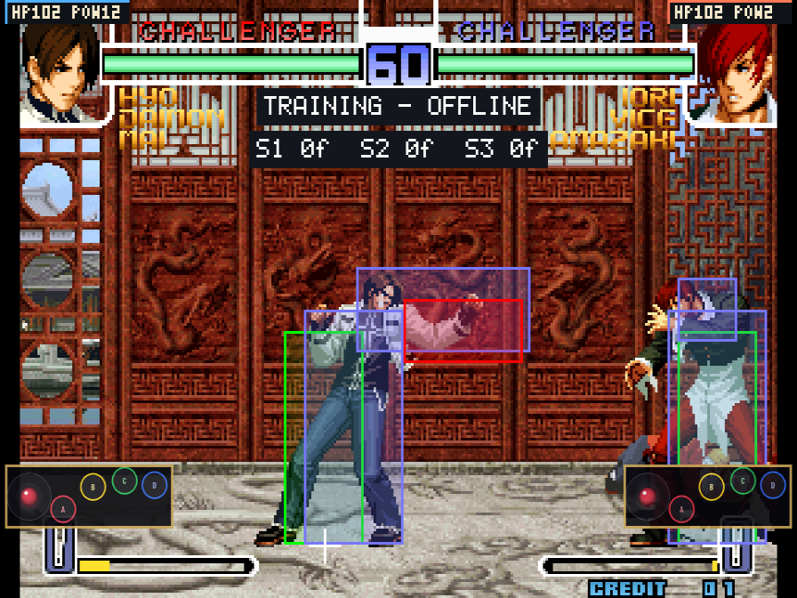

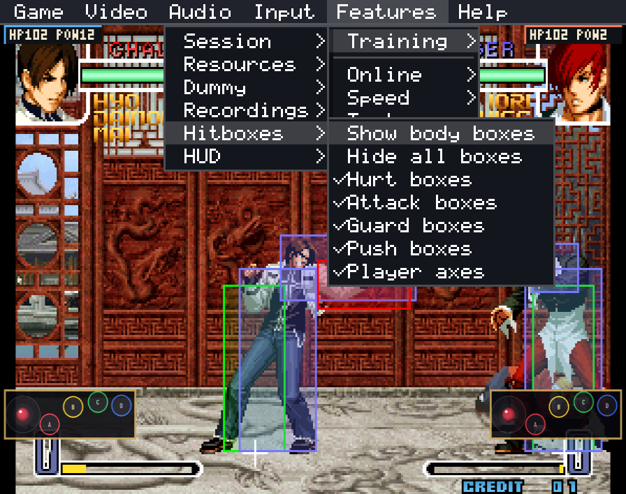

### Throw attempts

Enable **Training > Hitboxes > Throw attempts** for yellow event-time attempt
areas. They can last only one displayed frame; pause to inspect one. The area
belongs to the observed attempt, **not the opponent's throwability zone**, and
does not predict success. Hide all boxes also disables this option.

The read-only observer uses this set's0x10e7b5 watchpoint and0x10b08e camera.
At most one current-frame event per player is retained. Load/reset, option/session
exit, online and replay viewing discard stale events. The capture is not saved
in game state and does not resurrect when an old frame is loaded.

Thirty-one sampled C/D attempts match the original Lua callback, covering both
players and facings. Command throws, aerial throws and complete
roster coverage remain separate work. See [attempt evidence](../../openspec/changes/neogeo-training/kof2002-throws-receipt.json).

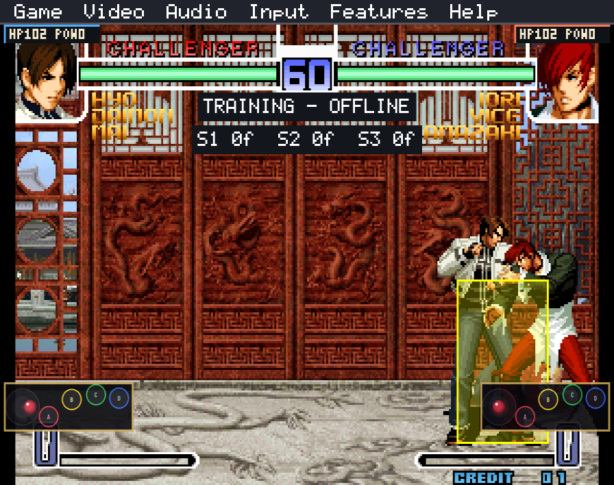

## Build and run

In the MSYS2 UCRT64 shell (the same dependencies as KOF97):

```sh
make GAME=kof2002
build/kof2002/kof2002 --rom /path/to/kof2002.zip
```

You can also double-click `kof2002.exe`. Without `--rom`, it searches for `kof2002.zip` in this order:

1. `roms/`, `ROM/`, `rom/`, then directly beside the executable.
2. `roms/` in the current working directory, then directly in that directory.

Keep `neogeo.zip` beside the game set. The collection's existing `ROM/` folder works without renaming or moving
anything, even when the executable is opened from another working directory. An explicit `--rom` always wins;
an invalid selected set reports its validation error instead of silently selecting a different copy.

The Windows executable embeds the actual title-screen logo as its icon, with sizes from 16 to 256 pixels, following
the collection's icon convention. Windows Explorer may briefly retain an older cached icon after replacement.

The collection discovers `games/kof2002/game.cfg` through `make collection`. Controls and the in-game menu are the
same as KOF97. The original ROMs are checked by CRC before any decryption. FIX is extracted from decoded sprites;
there is no S1 file. The loader rejects unexpected original-set region sizes.

## Checks

```sh
cmake -S . -B build/kof2002 -DNEOGEO_BUILD_TESTS=ON -DGAME=kof2002
cmake --build build/kof2002
ctest --test-dir build/kof2002 --output-on-failure
mkdir -p work/kof2002-check
build/kof2002/kof2002 --headless --rom /path/to/kof2002.zip --frames 6000 --stats \
  --script "3100:coin1:1,3250:start1:8" --shot-every 600 --shot-dir work/kof2002-check \
  --hash-log work/kof2002-check/hashes.txt --audio-dump work/kof2002-check/audio.wav
```

The synthetic tests need no game ROMs. They verify all five region CRCs against upstream MAME on two deterministic
artificial cartridges, all four Z80 bank windows, malformed-layout rejection without mutation, loading order,
CRC failure and isolation from other set IDs. See `tests/mame_decrypt_reference.py` for reproducing the MAME golden
CRCs. Test data belongs in ignored build/work folders.

The important sound-layout distinction: this board stores linear M1 data. MAME's extra 64 KiB audiocpu prefix must
not be inserted here. The encrypted 128 KiB input is zero-extended to 512 KiB before address decryption; the Z80
banks use MAME's 18-bit address limit. See the design and validation report under
`openspec/changes/neo-kof2002-decrypt/` for sources and observed results.


## Optional ForkAde match flow

`--forkade-online` explicitly enables the native Esc-menu Host/Stop flow,
arcade admission, independent Start prompts, player names/Hide toggles,
completed-human-team streaks and same-peer recovery. The optional Windows
room owner is built with `-DFORKADE_BROKER_DIR=/path/to/ForkAde`; it uses the
bundled tunnel and leaves normal execution/netplay unchanged. This does not
merge the separate menu-bar/training proposal or install a launcher update.

Result addresses were independently verified for this set; see
[the native observations](../../openspec/changes/neo-kof-family-match-flow/native-results.md).
Run `tools/check_neogeo_flow.py --game GAME --forkade-root PRODUCT
--baseline OLD_EXE --rom-dir SETS --out NEW_BUILD_DIRECTORY` for per-game
local acceptance, replacing GAME with this directory's set ID. Local probes
and loopback checks do not establish real Internet/player acceptance.

### Defender throw vulnerability

**Features > Training > Hitboxes > Throw vulnerability** shows a light-grey
reference-derived defender area. Yellow **Throw attempts** describes a different,
transient attacker event. Neither area guarantees that a particular throw connects.
The defender view respects the reference's restrictive status, invulnerability
timer, signed eligibility and proximity-guard conditions; zero-size areas are hidden.

Each set independently matches the original Lua in 600 native snapshots
(1,012 rectangles), plus 16 controls on copied snapshots. The viewer is read-only,
refreshes on paused load/reset, and hides online, in replay viewing and outside
training. **Hide all boxes** disables it too. Same-set save formats are unchanged;
never exchange original/variant states. Full-roster and command/air-throw qualification remains pending; projectile
coverage is described below. See [defender-area evidence](../../openspec/changes/neogeo-training/kof2002-throwability-receipt.json).

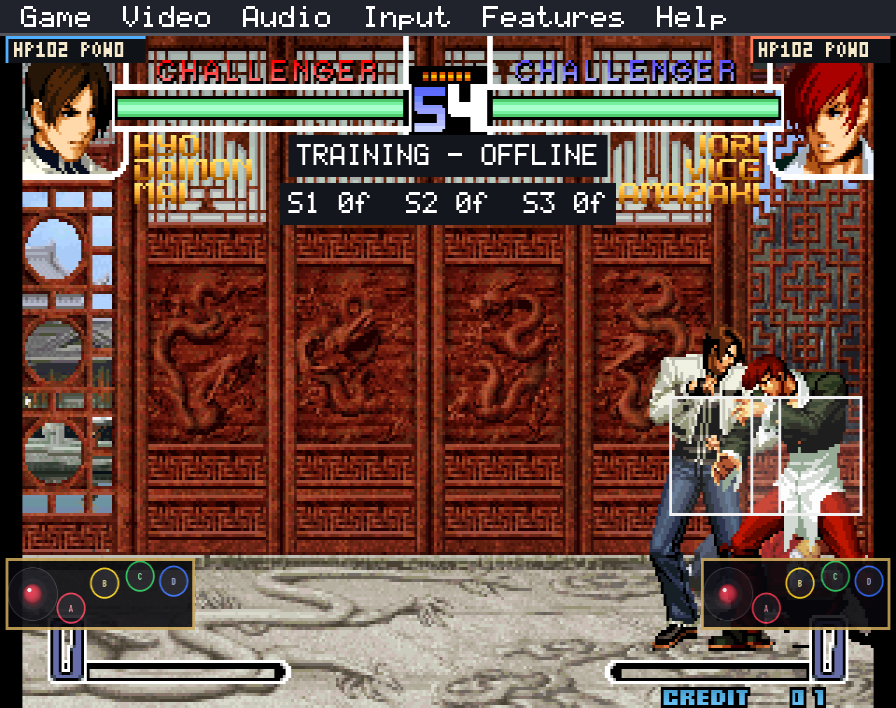

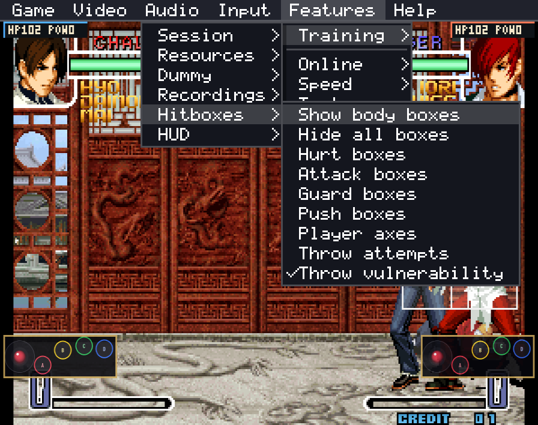

### Projectile boxes

**Features > Training > Hitboxes > Projectile boxes** independently shows magenta
projectile attacks and cyan projectile vulnerability. Body filters remain separate;
**Hide all boxes** disables everything. Ownership is not inferred from list order.
The read-only list is capped at 64 objects and discards incomplete projectile data
on malformed pointers or cap exhaustion while retaining valid player boxes.

This set independently matches the original Lua on native Iori projectile snapshots.
Paused load, expiry, switches, session exit and online/replay-viewing guards are
checked, with unchanged board/training state and audio regression. This does not
qualify every projectile, roster or collision outcome. Same-set save formats and
previous accepted packages remain unchanged. See [per-set projectile evidence](../../openspec/changes/neogeo-training/kof2002-projectiles-receipt.json).

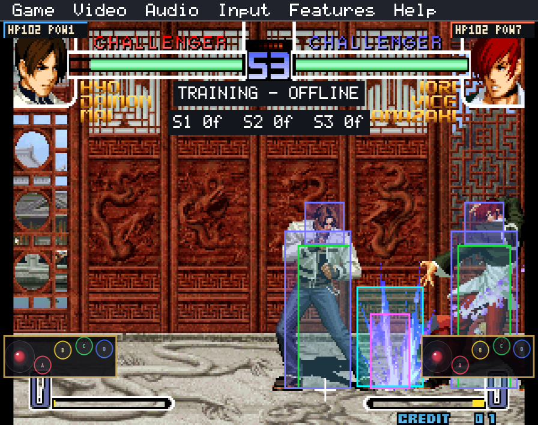

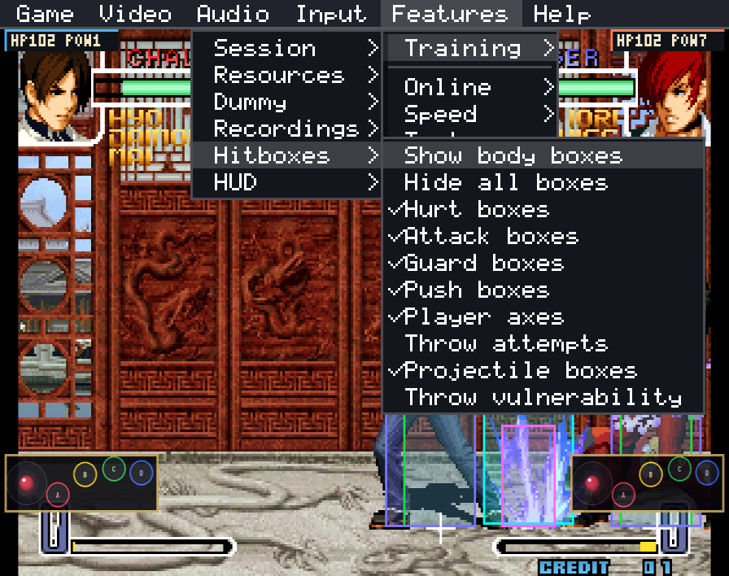

### Additional projectile coverage (24 November 2026)

The accepted projectile executable also matches the original Lua for Terry's
ordinary quarter-circle-forward + A sample: 65 snapshots / 122 projectile
rectangles per set. Each visibility setting preserves hashes and PCM over 900
frames; native presentation preserves complete board/game state. A separate C
sequence produced no projectile and is not counted as positive move coverage.
Terry versus Leona was selected through normal menus, without fighter-ID patches.
No new binary or save format is required. Other moves, fighters and facing
combinations remain unqualified.

[Per-set expanded evidence](../../openspec/changes/neogeo-training/kof2002-projectile-roster-receipt.json).

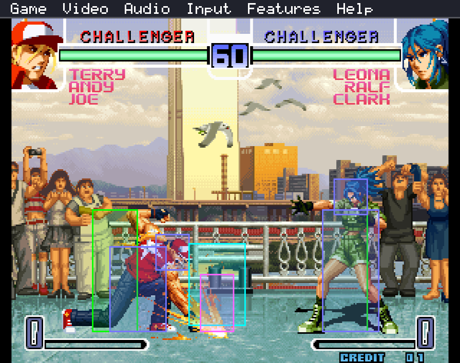

### Athena projectile coverage (24 November 2026)

Athena's normally selected ground quarter-circle-back + A and + C samples
independently agree with the original Lua in this set: 117 + 58 snapshots,
covering 227 + 114 projectile rectangles. Each input has 900 visibility-off and
900 visibility-on frames with identical hashes/PCM and read-only presentation.
No replacement executable is needed. The initial forward-motion attempt produced
no projectile and is not counted as move coverage. Other moves/facings remain
pending. [Athena evidence](../../openspec/changes/neogeo-training/kof2002-projectile-athena-receipt.json).

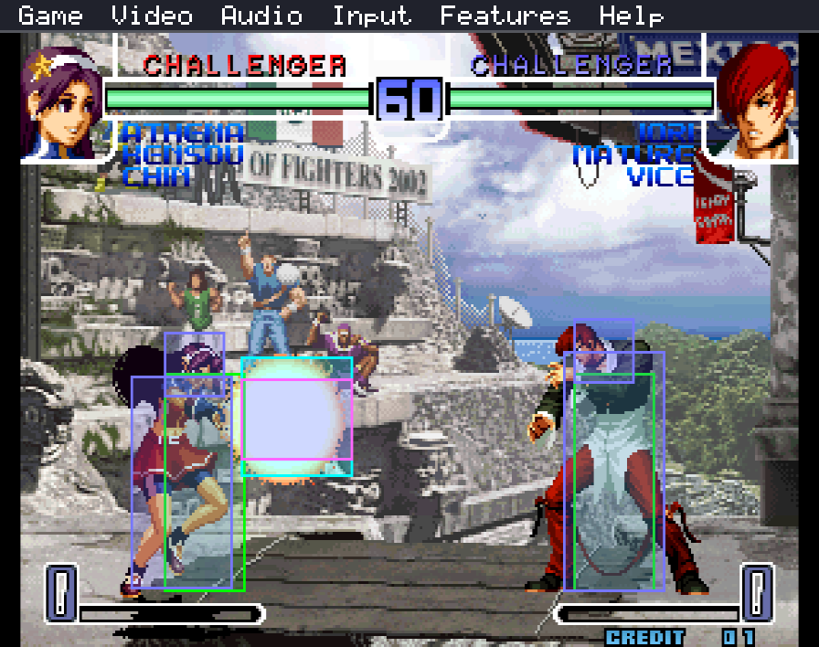

### Opposite initial facing (24 November 2026)

Normal dummy jump/walk inputs cross the players before testing Athena A/C and
Terry A again. Facing and player X ordering are checked; no RAM patch is used.
The left-facing samples add 260 snapshots and 501 projectile rectangles
matching original Lua in this set. Each of three inputs runs 900 frames per
visibility setting with equal hashes/PCM and read-only native presentation.
Together with prior right-facing samples, this covers the two initial orientations
for these particular P1 inputs. P2 roles, continuous crossings and the remaining
roster/moves remain separate work. Accepted executables remain unchanged.
[Opposite-facing evidence](../../openspec/changes/neogeo-training/kof2002-projectile-opposite-receipt.json).

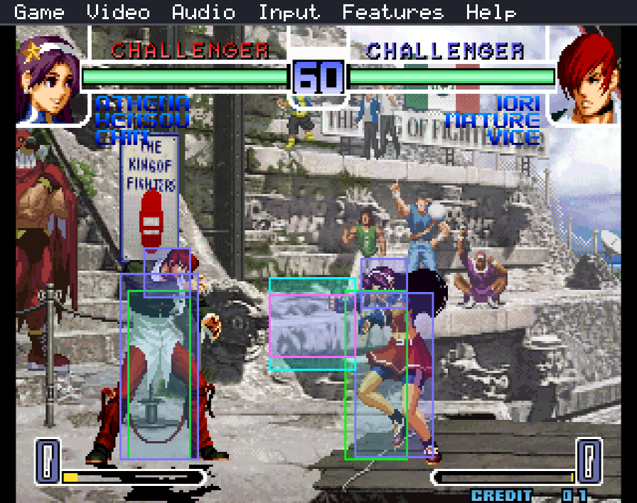

### Player-two projectile coverage (24 November 2026)

Athena A/C and Terry A are also qualified as P2 in this set, from the normal
right-side, left-facing start. Normal selection captures identify each fighter.
The existing dummy-recording route drives P2 while P1 stays neutral; this does
not certify physical-controller mapping or Internet play. Three sequences each
run 900 visibility-off and 900 visibility-on frames with equal hashes/PCM and
read-only presentation. 241 snapshots and 471 projectile rectangles
match original Lua. P2's opposite initial orientation and broader move/roster
coverage remain pending; accepted executables are unchanged.
[P2 evidence](../../openspec/changes/neogeo-training/kof2002-projectile-p2-receipt.json).

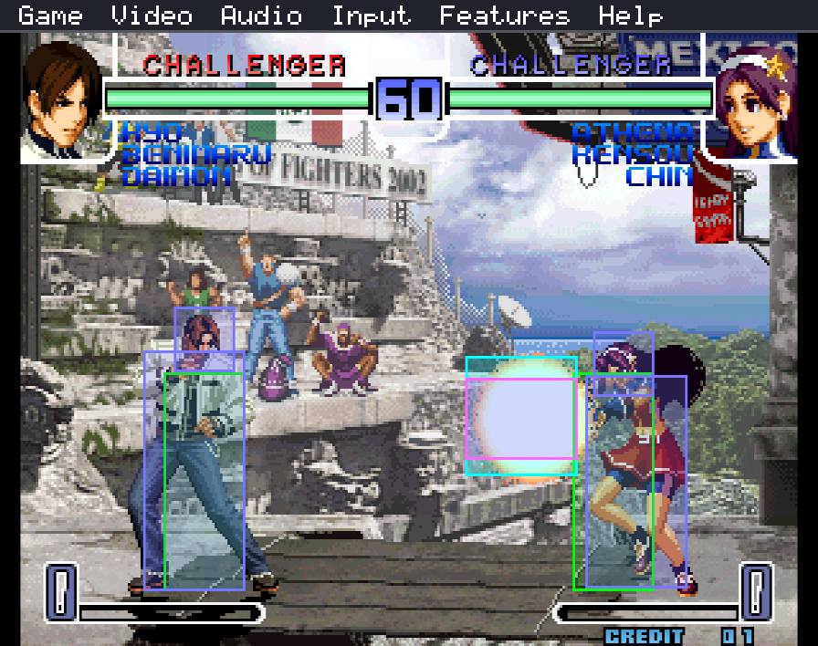

### Crossed player-two facing (24 November 2026)

Ordinary P1 jumps/walking cross P2 to the left side facing right; facing and X
ordering are asserted before the fixture is saved. P2 Athena A/C and Terry A add
276 snapshots / 537 projectile rectangles matching original Lua.
Each input has 900 visibility-off and 900 visibility-on frames with identical
hashes/PCM, P1 neutral during the attack exercise, and read-only native presentation.
Together with prior receipts, both initial facings and both player roles are now
sampled for these three inputs. This is not full-roster/move or dynamic-crossing
certification. Accepted executables remain unchanged.
[Crossed P2 evidence](../../openspec/changes/neogeo-training/kof2002-projectile-p2-opposite-receipt.json).

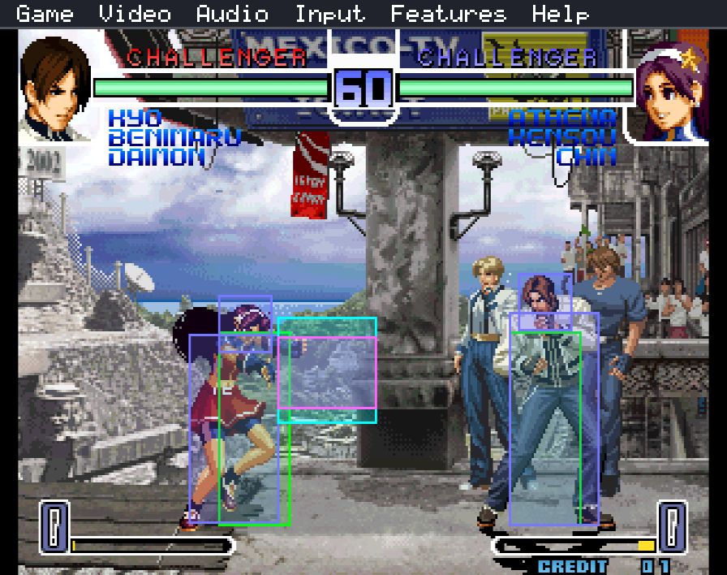

[Sampled role/facing coverage matrix](../../openspec/changes/neogeo-training/projectile-coverage.md).

### Kensou and Andy projectile samples (24 November 2026)

Normal character selection independently reaches Kensou or Andy P1 versus Iori P2.
Quarter-circle-back + A and + C samples agree with original Lua in this set:
272 snapshots / 532 projectile rectangles across four inputs.
Each runs 900 visibility-off and 900 visibility-on frames with identical hashes/PCM,
expected native geometry and read-only presentation. These are initial P1 right-facing
samples only; P2, opposite-facing and broader move coverage remain pending for
these fighters. Accepted executables are unchanged.
[Additional-roster evidence](../../openspec/changes/neogeo-training/kof2002-projectile-extra-roster-receipt.json).

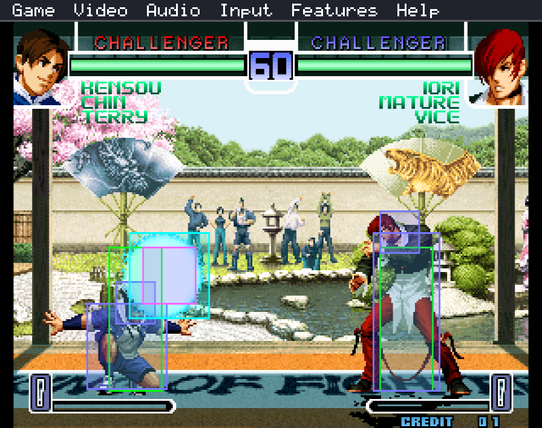

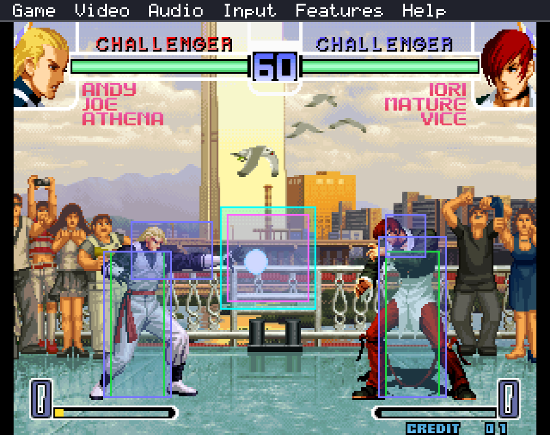

### Kensou/Andy sampled role/facing matrix (24 November 2026)

The remaining P1 left-facing and P2 left/right-facing qcb+A/C samples are now
checked independently in this set: 848 additional snapshots and 1622
projectile rectangles agree with original Lua. Normal P2 selection and jump/walk
crossings establish the fixtures with facing/X-order assertions. Each of twelve
new input exercises has 900 visibility-off and 900 visibility-on frames with
identical hashes/PCM, inactive-player input neutrality and read-only native geometry.
Together with the initial P1 samples, this covers both roles and initial facings
for these four inputs only. Other moves, dynamic crossings and full-roster claims
remain outside this evidence. Accepted executables and saves stay unchanged.
[Expanded matrix evidence](../../openspec/changes/neogeo-training/kof2002-projectile-extra-matrix-receipt.json).

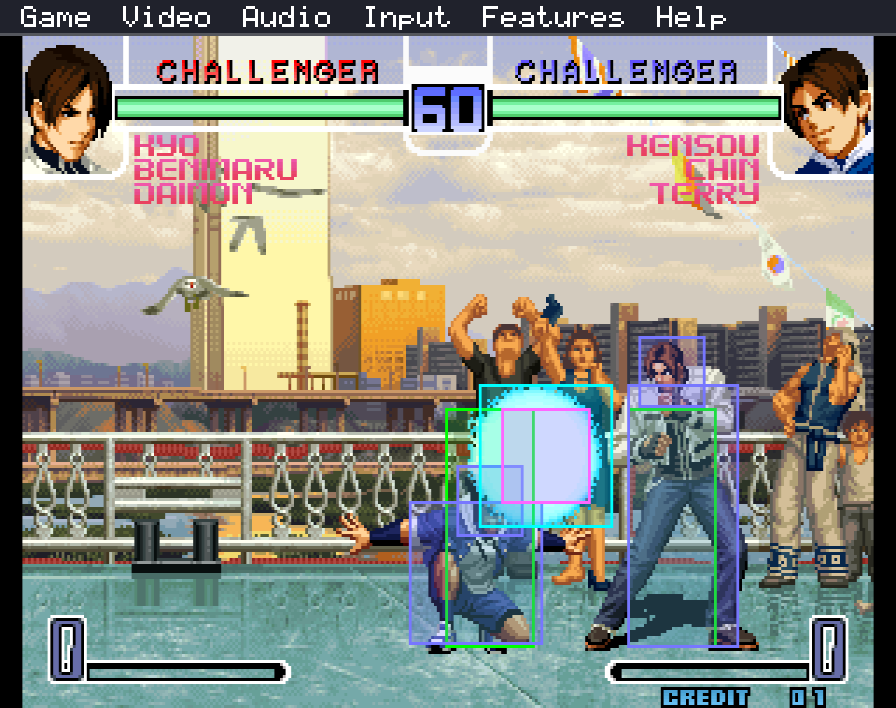

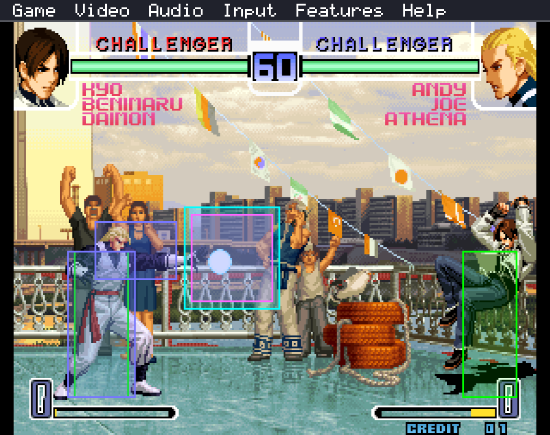
