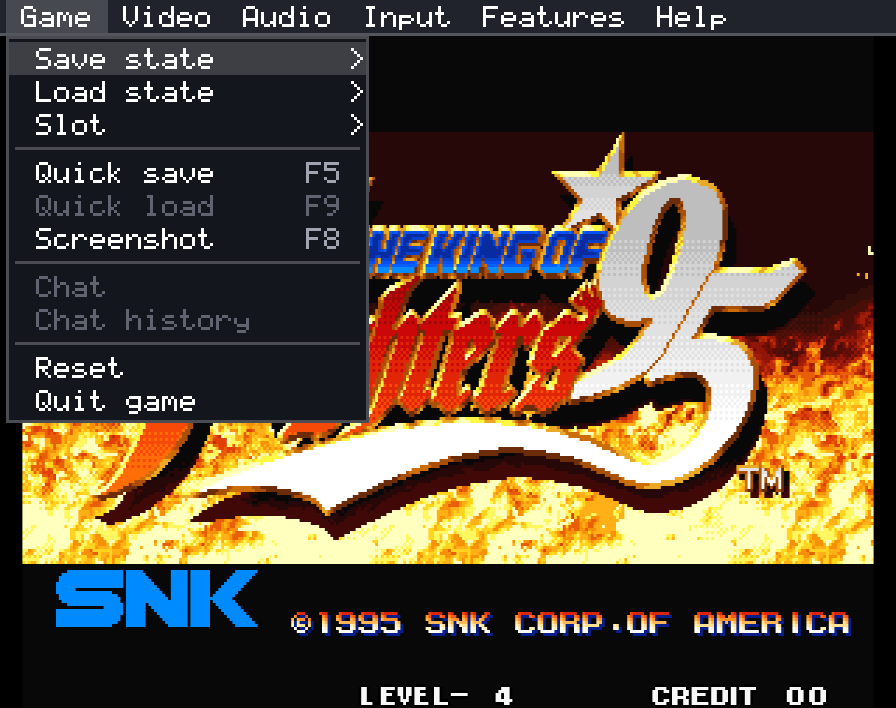
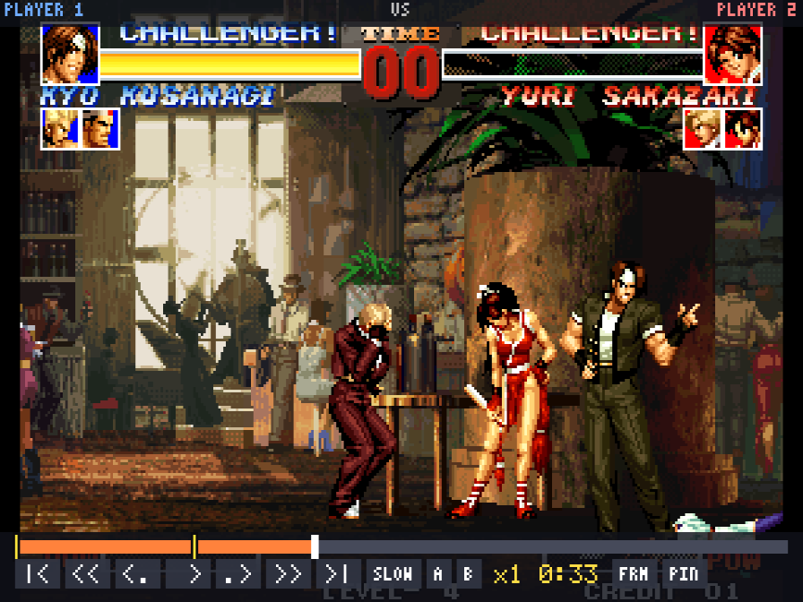
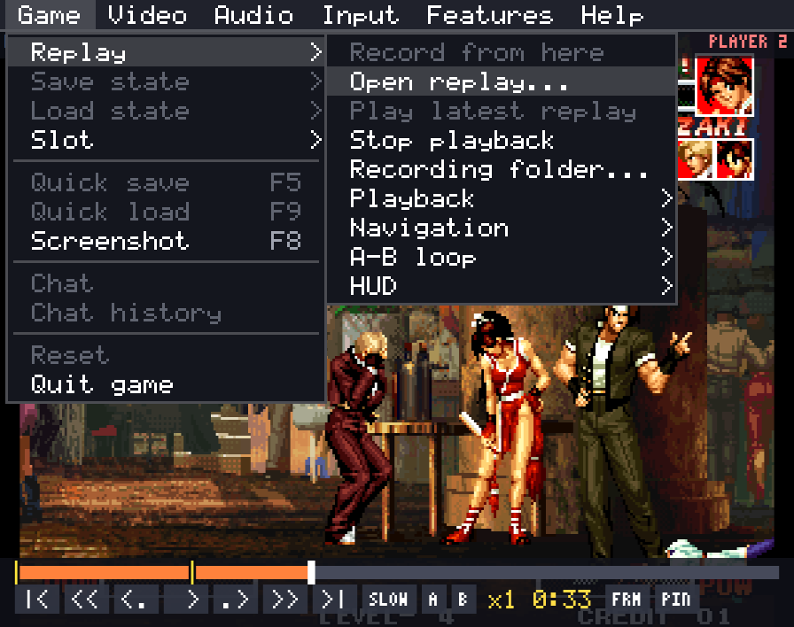
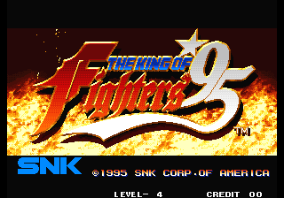
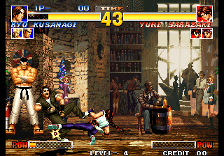

# The King of Fighters '95 (MVS)

This candidate runs the original `kof95` cartridge on the existing Neo Geo board. The Windows executable is native host code; its 68000 and Z80 are interpreted. It is not a completed static translation.

## Your files

Supply your own `kof95.zip` and `neogeo.zip` beside one another. `game.cfg` records the original MVS filenames and CRCs; AES/alternate sets are not interchangeable. No game or BIOS data is included here. The loader only reads your archives.

## Building and running

Use the dependencies listed in the root README (C++20, CMake, Ninja, Python, SDL3, zlib and the pinned GekkoNet source). In an MSYS2 UCRT64 shell:

```sh
make GAME=kof95
build/kof95/kof95.exe --rom /path/to/kof95.zip
```

For diagnostics without a desktop window:

```sh
build/kof95/kof95.exe --headless --rom /path/to/kof95.zip --frames 3600 --hash-log hashes.txt
```

Keep states, settings and captures in a separate user/output directory. A command with `--rom` is not evidence that launcher discovery or a portable package has been accepted.

## Menu and local controls

The reconciled top bar provides Game, Video, Audio, Input, Features and Help. F10, Alt or right-click opens it; offline play pauses while it is open. F5/F9 save/load the selected slot, F6/F7 change slots and F8 captures a screenshot. Minus/equal change volume in 5% steps; brackets change speed. Save slots show a thumbnail. Help links to the source repository. Product-online acceptance remains separate work.



## Local replays and viewer

Two-human local versus games are recorded automatically as format-2 `.fareplay` files. CPU-only play and attract mode do not create automatic recordings. Recording finishes after versus ends, or on a normal exit; reset, state loading and configuration changes end the current recording. Each recording is limited to 72,000 frames (about 20 minutes). An interrupted process cannot guarantee a finalised file.

Open **Game > Replay > Recording folder...** to choose a folder outside your ROM directory. With an explicit save path, the default is `replays` next to that save; the local test package therefore uses `user/replays`. **Record from here** captures another offline segment manually. **Open replay...** selects a file, and **Play latest replay** opens the latest file in the chosen folder. Stop playback restores the game state from before viewing.

The viewer provides pause, frame steps, rewind, fast-forward, slow motion, round markers, timeline navigation and A–B loops. Use its mouse controls or the grouped Playback/Navigation menu. Keyboard shortcuts include Space/P for pause, comma/period for frame steps, arrows for speed, Home/End for the endpoints, Page Up/Page Down for markers, A/B/C for loop boundaries/clear and V for the HUD. Controller face buttons support pause and frame steps; physical viewer-controller acceptance is still pending.

The file stores inputs and an initial state, rather than a video. Viewing requires your own matching ROM/BIOS and compatible game/state source identity. Incompatible identities, malformed state layouts and checksum mismatches are refused. Keep recordings private: their initial state can contain game data. Source compatibility is conservative and is not a promise of cross-version or cross-platform replay support.

**Online sessions now record a confirmed segment automatically.** The file is finalised on session exit/disconnection or recovery, takes only the contiguous verified input/state prefix and omits unresolved rollback tails. It contains at least 60 and at most 72,000 frames. The current cap saves the first segment; automatic rotation for a longer session is not implemented. Spectators do not record. Unlike local versus segmentation, an online segment may include menus and character selection; it does not claim to be a scored set.

Online capture has passed forced-rollback and two-process loopback tests; play with another PC over the Internet remains an acceptance gate. Recorded names are session nicknames, not authenticated identities. Verified scores/results, video export and launcher file associations are separate work. The viewer does not invent results.

For a command-line recording and playback:

```sh
build/kof95/kof95.exe --rom /path/to/kof95.zip --record-replay /output/example.fareplay
build/kof95/kof95.exe --rom /path/to/kof95.zip --replay /output/example.fareplay
```





## Cartridge assembly

MAME revision `8c285468743535fbbde018fef23b3cfb8c9a3ec8`, `src/mame/snk/neogeo.cpp`, defines the MVS set. After the ordinary 16-bit word swap, P1's two 1 MiB halves change places. Samples retain a 2 MiB gap at `0x600000`; sprite data retain a 4 MiB gap at `0x1400000`. `machine/kof95_layout.h` assembles these regions in memory after exact region-size validation. This is layout handling, not KOF2002 decryption.

## Demonstration and current limits





These are unmodified headless captures of the actual game, not concept artwork. `images/provenance.json` identifies the source capture and executable. The icon is derived from the title logo with its aspect ratio retained.

Offline bring-up is a milestone. The complete shared product baseline (exact states, rollback, menu bar, format-2 replay/viewer, names, volume, applicable unlock, spectators/chat and launcher) is tracked in `openspec/changes/neo-kof95/`. A title capture does not claim that every baseline feature or Internet play is finished. See that change's validation report for tested commands and remaining work.

## Credits

SNK created the game; the game rights remain with their holders. Tommy McLeroy's CPS-2 Recomp/toolkit provides the project foundation; the Neo Geo implementation and region definitions follow MAME, with YM2610 audio from Aaron Giles' ymfm and rollback from GekkoNet. The replay codec and shared viewer were adapted/reused from the CPS fork at revision `61d62cdde595c798f0de059e583e17fa76f12496`; original notices remain in the files. KOF95 timer observations are corroborated by peon2's [FBNeo training-mode script](https://github.com/peon2/fbneo-training-mode/blob/master/games/kof95/kof95.lua); local two-human recording detection was independently checked against runtime traces. See the root `THIRD_PARTY_NOTICES.md` for code licences and attribution. Cartridge layout facts are referenced above; no ROM content is copied into source.
