# The King of Fighters '98

> Development status, 24 November 2026: newer training features and captures below
> describe local candidates whose implementation changes are pending separate source
> publication. See [the development report](../../docs/TRAINING-DEVELOPMENT.md).

Original encrypted `kof98` (NGM-2420): 242-p1.p1 CRC 8893df89, 242-p2.sp2 CRC 980aba4c. Supply your own kof98.zip
and neogeo.zip together. Predecrypted and alternate M1 sets require their own definitions; no ROMs are distributed.

The loader validates P=6 MiB, S=128 KiB, M1=256 KiB, C=64 MiB and V=16 MiB before the MAME program transform.
Only P is transformed; the Altera header overlay is handled by the board at 0x100/0x102 and 0x20aaaa. Its state
is saved/restored for rollback; unrelated cartridge state layouts are unchanged. This native host uses the
existing 68000 interpreter, not a complete static translation.

Build in the existing UCRT64 environment: `make GAME=kof98`. Run `build/kof98/kof98 --rom /path/to/kof98.zip`.
For direct EXE startup keep both sets in ROM/ (also roms/ or rom/) beside the EXE. Shared library routing is provided
by ForkAde. The game carries its own title-screen icon in seven sizes.

Online uses the existing GekkoNet implementation and ForkAde host/join controls. Both peers need the same build,
sets and settings. Local peer/rollback checks are distinct from real Internet acceptance; see the OpenSpec report
under openspec/changes/neo-kof98 for the exact tested scope. No deployment replaces the working beta automatically.


## Optional ForkAde match flow

`--forkade-online` explicitly enables the native Esc-menu Host/Stop flow,
arcade admission, independent Start prompts, player names/Hide toggles,
completed-human-team streaks and same-peer recovery. The optional Windows
room owner is built with `-DFORKADE_BROKER_DIR=/path/to/ForkAde`; it uses the
bundled tunnel and leaves normal execution/netplay unchanged. This does not
merge the separate menu-bar/training proposal or install a launcher update.

Result addresses were independently verified for this set; see
[the native observations](../../openspec/changes/neo-kof-family-match-flow/native-results.md).
Run `tools/check_neogeo_flow.py --game GAME --forkade-root PRODUCT
--baseline OLD_EXE --rom-dir SETS --out NEW_BUILD_DIRECTORY` for per-game
local acceptance, replacing GAME with this directory's set ID. Local probes
and loopback checks do not establish real Internet/player acceptance.


## Native offline training — first slice

The first native training session is available for the original `kof98` set. Open
**Features > Training > Session > Start training** (also in the Esc-menu Training page).
Coins/Start are supplied through the normal controls; P1 chooses both teams.
During verified two-human battle, the first slice offers living-fighter health
refill, a clock held at 60, and a P2 dummy that stands, crouches, guards or guards
low. Guard direction follows the verified facing flag. POW is displayed read-only;
MAX refill is deliberately not implemented yet.

**Reset round**, Backspace or an unbound controller left shoulder restores the
first verified battle checkpoint. **End training** disables practice effects and
returns P2 to its ordinary controls. F5/F9 save/load the training checkpoint and
dummy slots/playback as part of the normal state; use the same training feature choices for
an exact continuation. A malformed state load preserves both the prior board
and the prior training state.

The optional HUD shows verified HP/POW above the portraits and current effective
P1/P2 inputs only, using the user's recorder's actual rendered buttons and ball-top
joystick. The stick centres for neutral and moves for all eight directions.
ABCD uses red/yellow/green/blue in the MVS arc (A low-left). No P1/P2 labels or
history list; training panels sit immediately above the super meters. **Input > Neo Geo input
panel** offers Automatic (training HUD), On, or Off. Keyboard, gamepad, dummy and
compatible replay input all use the same effective board pads.

The complete panels are25% smaller than the first recorder version, with12%
transparency blended once over the actual game picture. Controls are composed on a3x presentation picture, preserving the recorder's
original font, reflection and glow instead of reducing artwork to224 lines first.
Both interactive GPU/SDL presentation and offscreen GPU captures use this path;
the menu layer remains above it. Raw native screenshots remain224-line images.
Python/Pillow and font files are not runtime dependencies. Asset source/output
hashes and font notice are in [recorder artwork](../../assets/recorder-inputs/README.md).

### Three dummy slots

Open **Features > Training > Recordings**. Choose **Selected slot** (1–3),
then **Record selected slot**. P1 controls are routed to P2 while P1 is neutral;
coin/Start/service inputs are omitted. **Stop dummy action** ends capture, up to
1,800 simulated frames per slot. Recording again replaces that slot only.

Choose **Playback mode**: Once, Loop selected, or Random slots; then **Play
selected slot**. Random chooses only populated slots, with deterministic saved
PRNG state. Forward/backward follow the dummy's facing on every frame. **Clear
selected slot** removes one tape. Reset/end stop the action but retain tapes in
the current process. F5/F9 save/load includes the tapes and playback cursor/seed;
there is no separate persistent recording library yet.

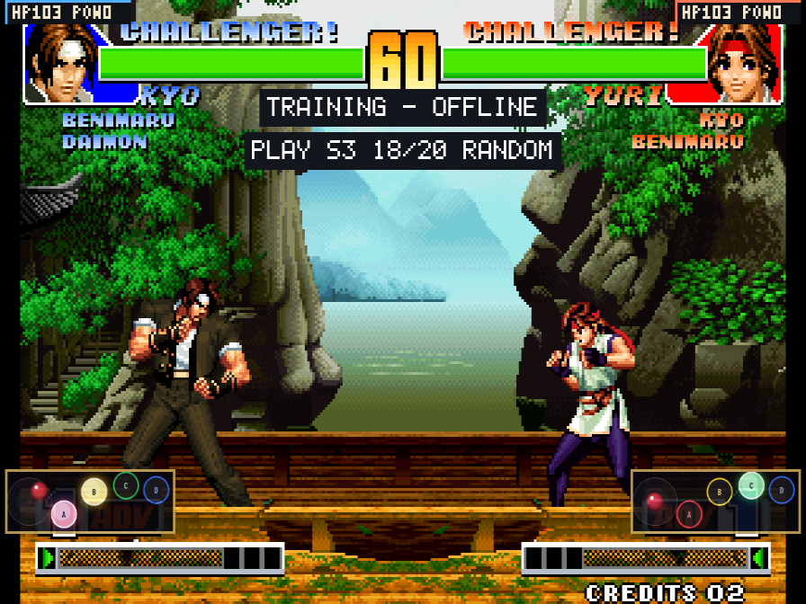

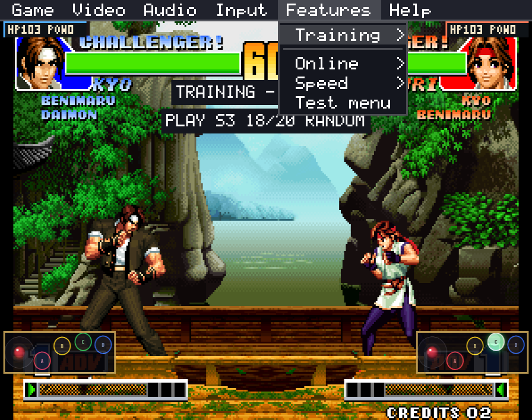

The older first-slice screenshots below document the previous HUD, not the new
current-only display:

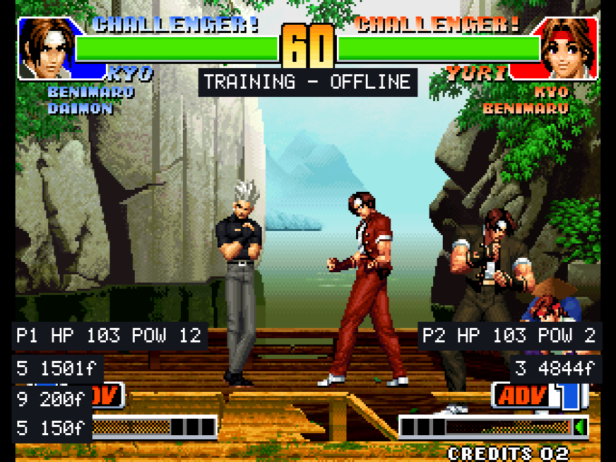

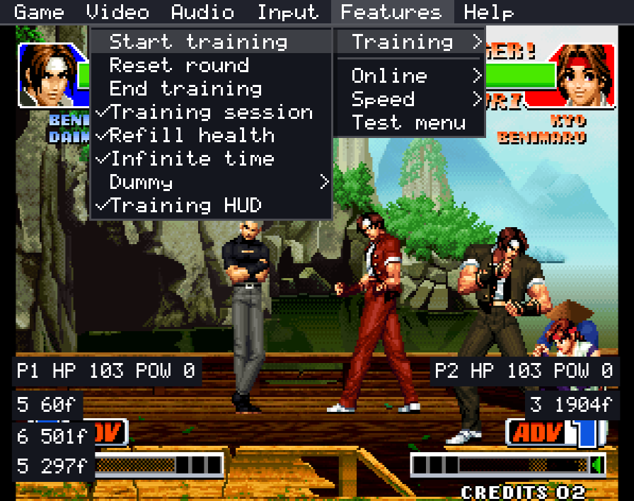

For diagnostics or a direct practice launch:

```sh
build/kof98/kof98.exe --rom /path/to/kof98.zip --features training_session,training_health,training_time,training_hud
```

Training mutations/dummy injection are blocked in online play and replay viewing.
Recording a match replay while training is active is currently refused; dummy
recording slots described above are separate from match replays. This is not yet
the full training suite: MAX refill, advanced guard policies, reversals, wake-up drills,
throwability areas, full throw-roster coverage, frame data and other training adapters still need verification.
Human controller acceptance and product/launcher packaging remain separate.

This is independent native C++ code, not an installed Lua extension. RAM research
used peon2's [KOF98 training reference](https://github.com/peon2/fbneo-training-mode/blob/master/games/kof98/kof98.lua)
and was checked through native bus traces. The design also considers
[Tommy's training contract](https://github.com/tmcleroy/cps2recomp/blob/main/docs/TRAINING.md)
and [willococa's extension](https://github.com/willococa/fightcade-kof-training-mode-extension).
No Lua code or artwork from those projects was imported. The first prototype used InputDisplay sprites from Delta3-Studio/lucasteles.
Player feedback led to reusing the user's recorder artwork directly. The active
renderer uses those recorded drawing outputs, not the InputDisplay prototype. The original
reference files retain their GPL-3.0 licence and provenance; see [asset provenance](../../assets/input-display/README.md)
and [third-party notices](../../THIRD_PARTY_NOTICES.md). SNK's game rights remain
with their holders; screenshots are actual demonstrations with executable
provenance. See `openspec/changes/neogeo-training/validation.md` for measured scope.


## Read-only player hitboxes

The native Training menu groups existing verified controls into six sections:

| Section | Controls |
| --- | --- |
| Session | Start, reset, end and session switch |
| Resources | Health refill and infinite time; meter remains read-only |
| Dummy | Stand, crouch, guard and low guard |
| Recordings | Three slots, recording, playback and clearing |
| Hitboxes | Body, projectile and partial throw-attempt views |
| HUD | Visibility, fixed panel anchors, text/resources and restore defaults |

Feature IDs, saved preferences, keyboard bindings and recorded input slots are
unchanged. This is a native menu, not a Lua host or a new training adapter for
other games. Free-form or draggable HUD placement remains separate future work.

### Optional HUD settings

**Features > Training > HUD** offers these presentation-only choices:

- **Input panels:** follow the global preference, force show or hide during offline practice.
- **Panel position:** Above supers (accepted default), Higher or Upper sides.
- **Status text:** Full, Session only or Hidden; recording/playback continues unchanged.
- **Portrait resources:** show/hide verified HP/POW without changing resource aids.
- **Restore HUD defaults:** reset these local choices and enable Training HUD;
  leave global inputs, dummy, slots, health/time and hitbox switches unchanged.

Choices update while paused. The global input preference and ordinary bottom
anchor apply again outside offline training. The panel size/transparency remain
unchanged; there is no mouse dragging. Explicit force-show can display inputs
even when automatic Training HUD display is off.

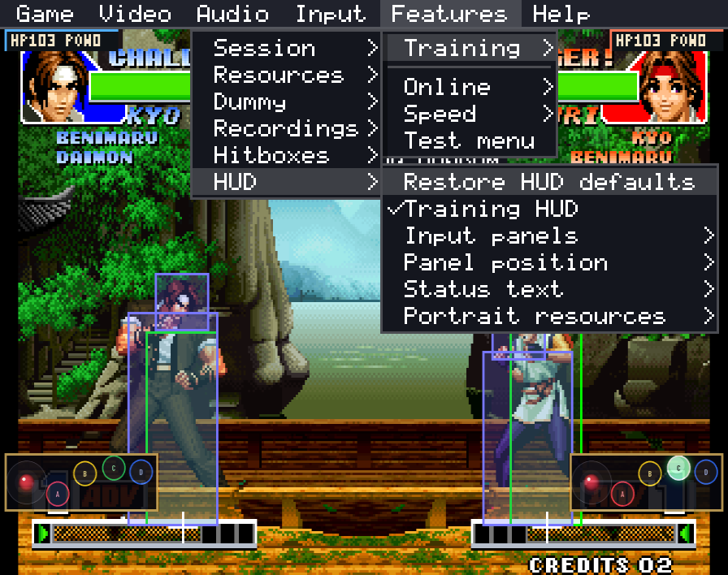

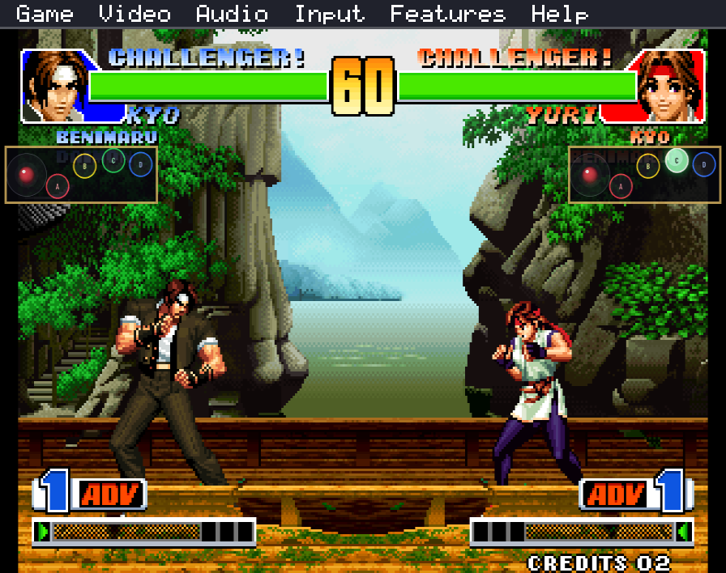

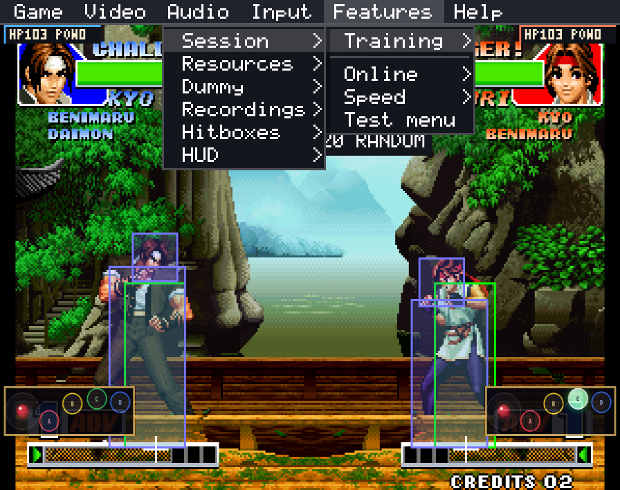

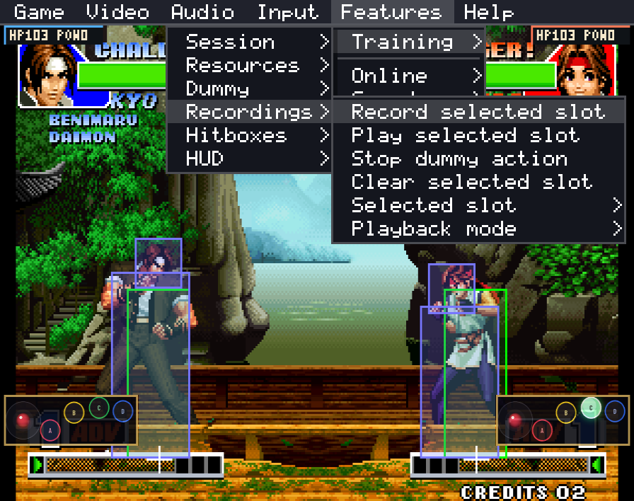

**Features > Training > Hitboxes > Show body boxes** enables player hurt (blue),
attack (red), guard (pale blue) and push (green) rectangles. Each type and white
position axes have independent switches; **Hide all boxes** turns them off.
The viewer reads current collision data every presentation, including pause,
state reload and round reset. It does not write RAM or alter gameplay/inputs.
It is disabled outside the offline training session and in online/replay viewing.

The body switch covers players. The separate **Projectile boxes** switch adds
projectile attack (magenta) and vulnerability (cyan) rectangles. Traversal is
bounded to 64 objects and discards partial projectile results on malformed data.
Projectile ownership is not inferred. Throw attempts have a separate partial
event-time view below; throwable areas remain pending.
It does not claim complete roster/move acceptance or frame-advantage measurements.
The Lua reference's write/execute-hook throw capture needs a separate native
adapter; its RAM-clearing fallback is not used. Other sets require independent
validation. The larger six-section training UI and drills remain work in progress.

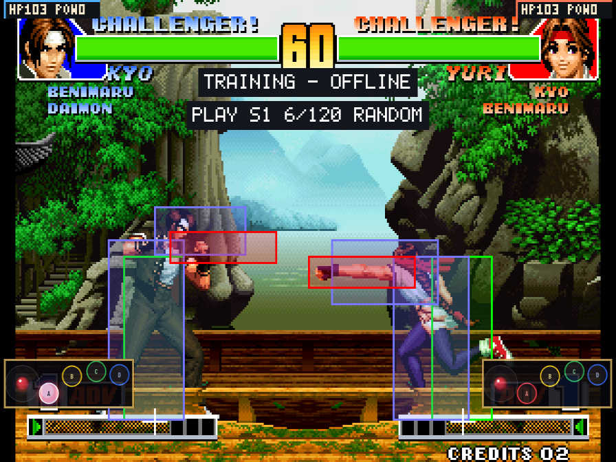

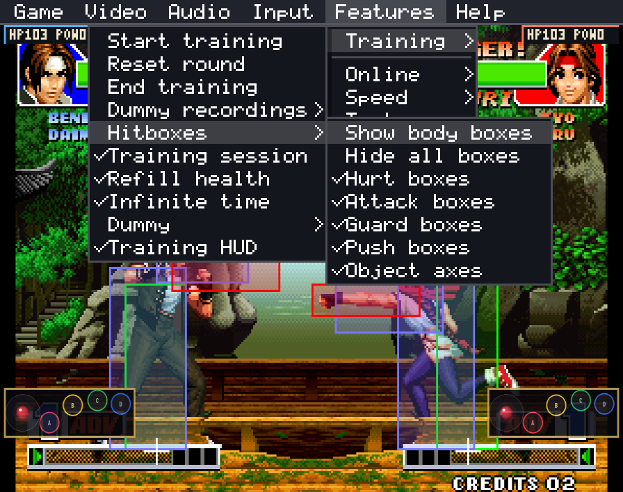

An independent native implementation was compared with the actual original Lua
viewer on120 snapshots of native RAM:730 rectangles agree, with both facings,
jumps and22 camera positions. Runtime ships no Lua DLL or scripts. See the
[reference audit](../../openspec/changes/neogeo-training/fbneo-reuse-audit.md),
[aggregate validation receipt](../../openspec/changes/neogeo-training/hitboxes-receipt.json)
and [credits](../../THIRD_PARTY_NOTICES.md). No RAM snapshots are distributed.

## Projectile inspection

Enable **Features > Training > Hitboxes > Projectile boxes** during offline
training. The same pause/load freshness and online/replay guards apply. This is
a collision-data viewer, not a damage predictor or complete frame-data tool.

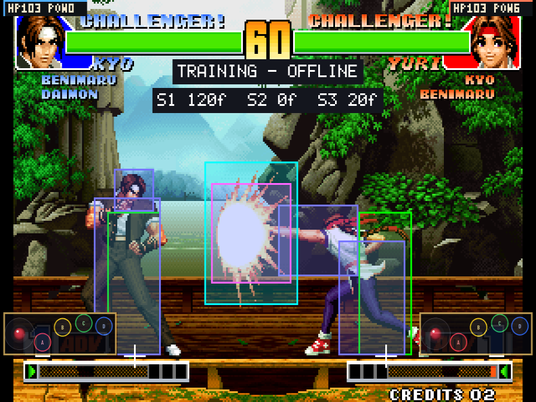

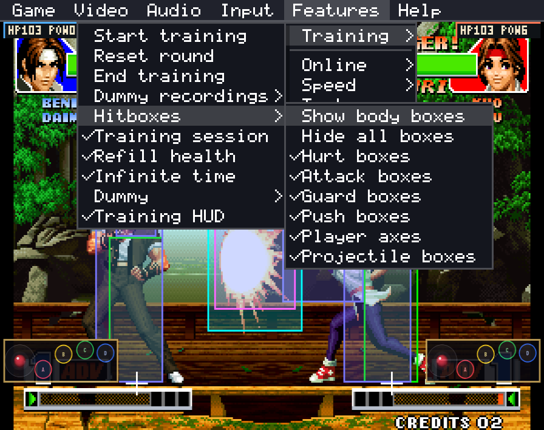

The original Lua viewer and the independent C++ reader agree on 291 rectangles
across 37 native projectile snapshots with Yuri, including 73 projectile rectangles.
This verifies the sampled scene, not every projectile or character. Production
ships no Lua interpreter, scripts or reference compiler. See the
[projectile receipt](../../openspec/changes/neogeo-training/projectiles-receipt.json).

## Throw attempts — partial coverage

**Features > Training > Hitboxes > Throw attempts** shows a yellow rectangle
when the verified KOF98 event supplies a valid player throw area. This captures
the attempt at the instant of the RAM write; it does not clear the game's fields,
predict success or show the opponent's throwability area. Coverage is sampled,
not certified for every character, normal throw, command throw or aerial throw.

Events can last only one frame. Use **P** to pause and **O** to advance a frame.
The paused event may remain visible; the next frame without an event clears it.
Loading a state, reset, online play, replay viewing and disabling the switch
invalidate cached events. Saved states do not resurrect old throw rectangles.
The diagnostics are excluded from the board's saved bytes and state hashes.

The independent reader matches the actual original Lua callback for twenty
captured events across both players. See the aggregate
[throw receipt](../../openspec/changes/neogeo-training/throws-receipt.json) for
native presentation, state/audio and regression evidence and its limits.

Additional opposite-side validation adds nineteen events. Together,39 sampled
rectangles agree with the original viewer, with each player facing both ways
across the two native scenes. Production observer on/off runs retain 1,200 frame
hashes and audio samples per player. This does not certify all throw types or a
full continuous side-switch sequence; see the
[orientation receipt](../../openspec/changes/neogeo-training/throw-sides-receipt.json).

### Iori command-throw sample

A separately confirmed Iori-versus-Brian fixture adds twenty A-only command-throw
event rectangles across two recorded input variants. The forward+A control has
no throw events. The successful runs swap sides without reducing Brian's HP,
and their production rectangles agree with the actual original Lua callback.
The current native throw switch already displays them; no additional runtime
patch was required. This is sampled coverage, not every command throw or aerial
throw. See the [Iori receipt](../../openspec/changes/neogeo-training/iori-command-receipt.json).

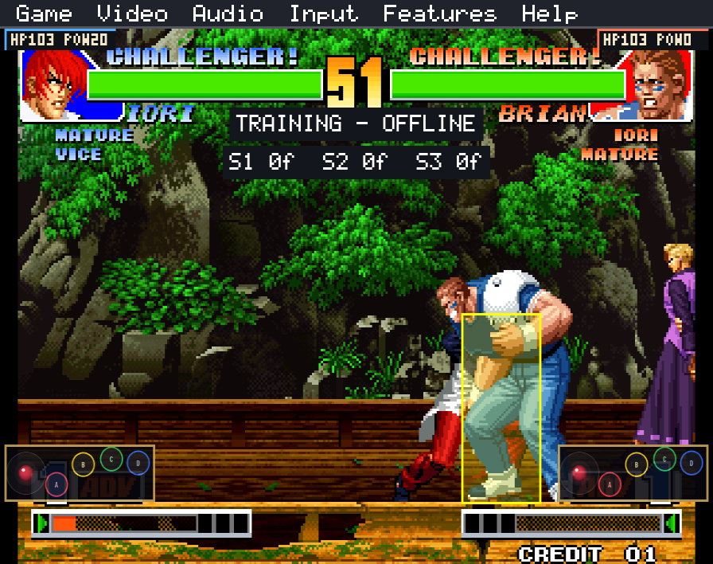

## Random standing guard

Select **Features > Training > Dummy > Behaviour > Random guard**. P2 chooses
relative back or neutral once when P1 starts an attack episode. The same choice
is retained until thirty frames without P1 attack buttons or verified body attack
boxes. It does not roll a new choice each frame. The HUD reports **RG GUARD**,
**RG PASS** or **RG WAIT** as an input intention, not a prediction of a successful
block. Low attacks need the explicit low-guard mode below; delayed projectiles
and reversals are not automatically covered.

Stop dummy recordings/playback first: those input slots retain priority. Pausing
does not advance decisions. State save/load preserves the seed and current
episode, so identical inputs/settings reproduce the decisions. Reset round ends
the episode while retaining its seed; starting/ending a session resets the sequence.
The sampled test produced twelve guard decisions and twelve pass decisions;
randomness does not guarantee equal counts in every sample.

Training state mark `0x4B393856` stores the bounded guard data and imports the
previous `0x4B393854`/`55` states with initial defaults. New states require this
candidate or a later compatible build. Invalid guard fields reject the load and
restore both the prior board and training state. The earlier candidate is kept
separately. See [validation evidence](../../openspec/changes/neogeo-training/random-guard-receipt.json).

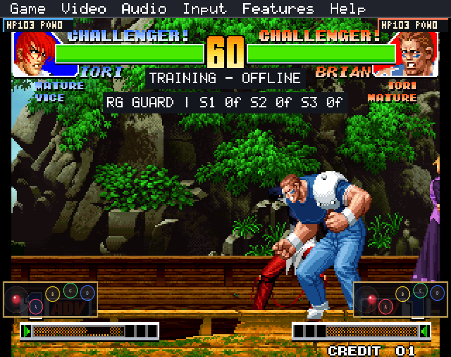

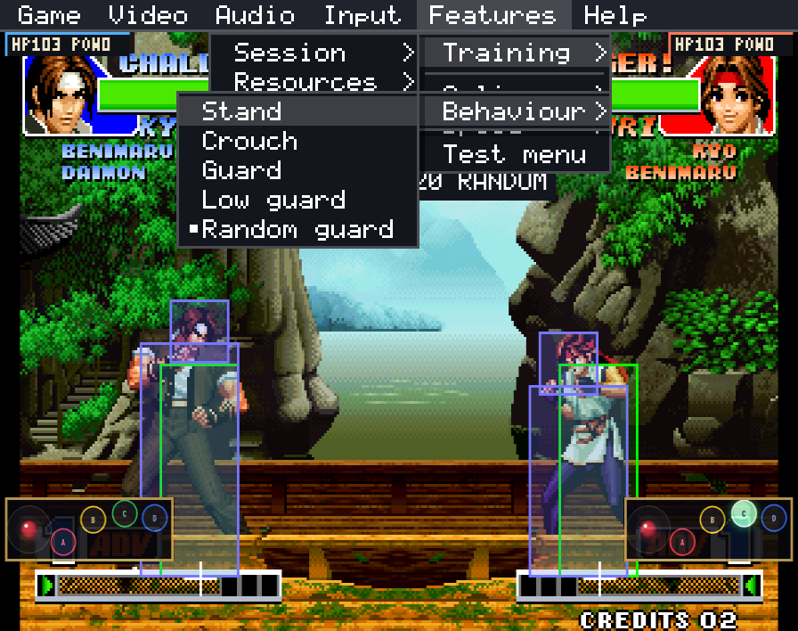

### Random low guard

Choose **Dummy > Behaviour > Random low guard** for an explicit low posture.
The chosen guard holds relative back plus down; pass remains neutral. The HUD
reports **RG LOW**, **RG PASS** or **RG WAIT**. This does not automatically read
attack height, block overheads or perform a reversal. Switching between the two
random postures retains the existing episode decision and seed.

In24 matched native trials of Iori's measured crouching attack, twelve low-guard
decisions take no damage and twelve pass decisions accumulate36 damage. Repeating
the guarded trials with the standing posture also accumulates36 damage. These
are sampled outcomes, not a promise for all attacks or characters. Recorded slots
still have priority. The low-guard qualification used state mark56; modes0-4 retain their IDs and
standing-mode hashes/audio agree with the earlier candidate.
See [low-guard evidence](../../openspec/changes/neogeo-training/random-low-receipt.json).

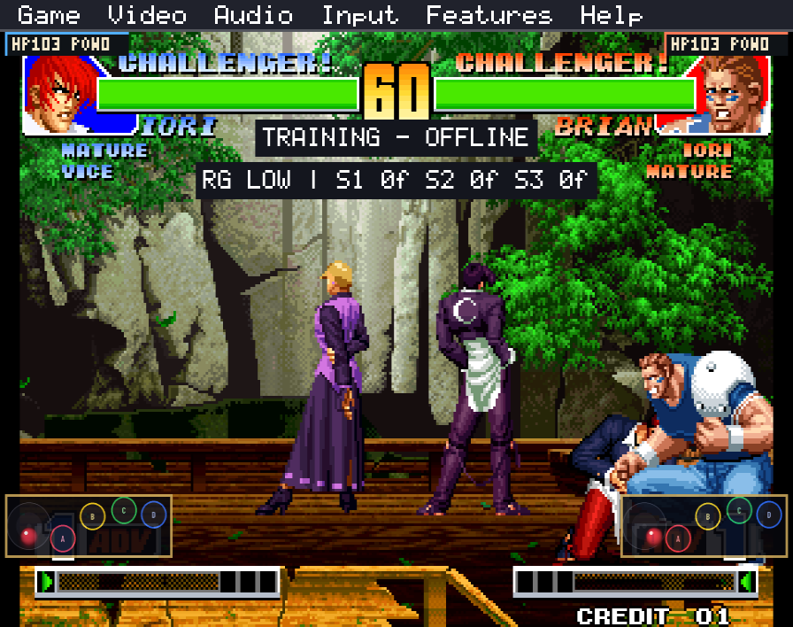

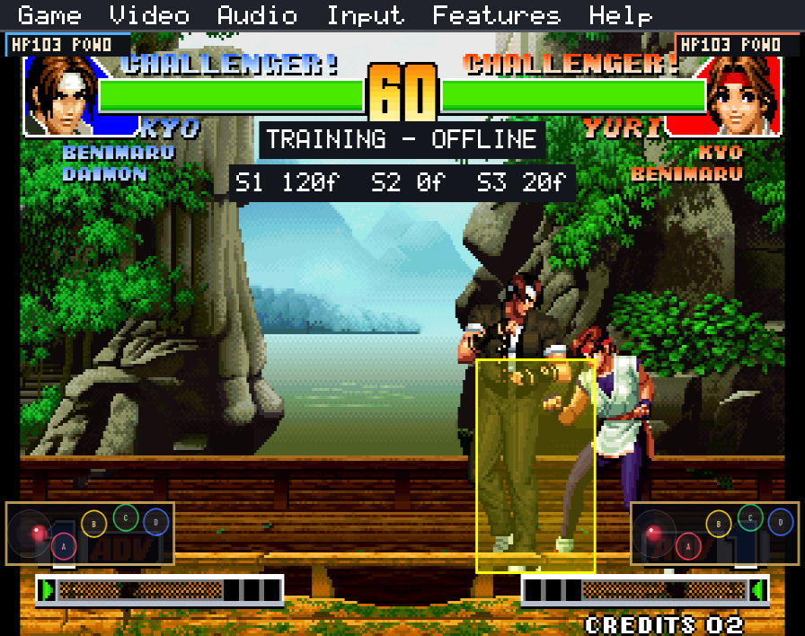

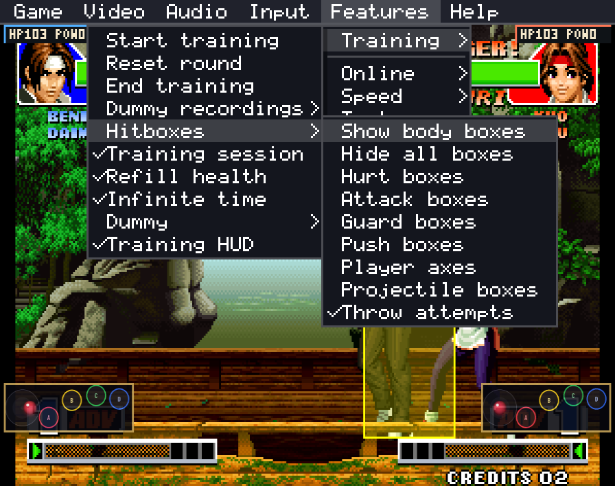

### Recovery-state foundation (development)

The state-only foundation first stored the pending recovery incident in training
mark57. Marks54/55/56 remain readable and start with no pending incident. Invalid
recovery fields reject the load through the existing board/game rollback path.
Reset, training exit, online/viewer guards and explicit recording ownership clear
pending work. The opt-in response below now adds ownership in mark58. Earlier
executables cannot read these new saves; keep their saves and candidates separately.

### Recorded recovery response

Record an action in **Training > Recordings > Selected slot** using **Record
selected slot** (P1 controls the dummy), then **Stop dummy action**. Choose
**Training > Dummy > Recovery response**: **After block**, **After hit**,
**After airborne hit**, or **After any**. The default is **Off**.

The chosen slot starts once after the sampled conservative recovery signal,
regardless of the manual playback mode. An airborne hit includes the measured
sweep recovery; it is not a universal ground-knockdown classifier. This is a
post-recovery exercise, **not a first-frame reversal**. The HUD uses **RESP**
while an automatic response owns playback. Empty slots do nothing. Explicit
record/play commands have priority; turning the response off stops its playback
without stopping an independently started manual loop.

It is disabled online and in replay viewing. Mark58 saves include response
ownership and slot cursor, while marks54–57 remain readable. Evidence covers
Iori/Brian and Kyo/Yuri; multi-hit, cross-up, throw and full-roster qualification
remain pending. See [response evidence](../../openspec/changes/neogeo-training/recovery-response-receipt.json).
